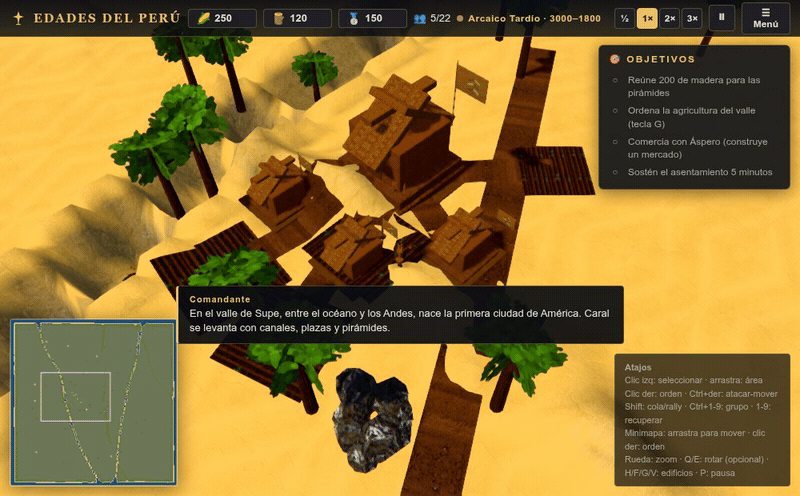
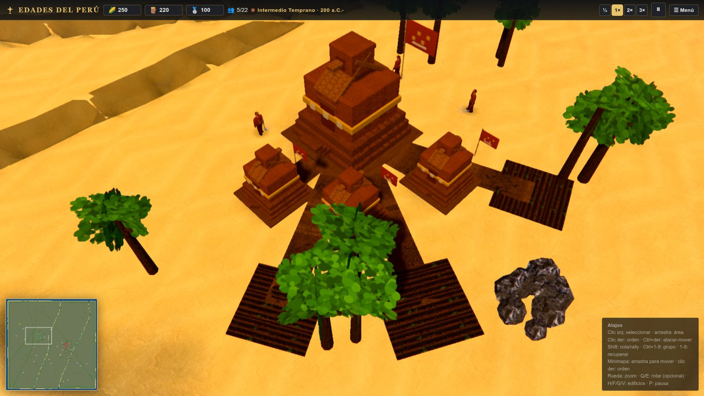
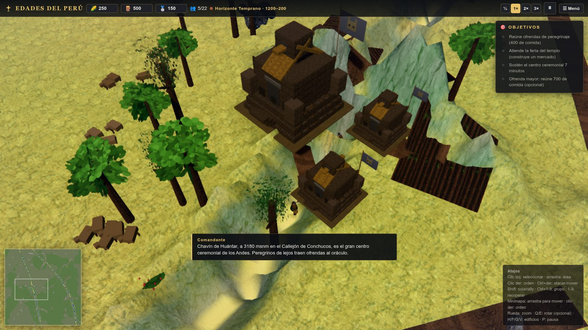

# EDADES DEL PERÚ — PERUVIAN HISTORY RTS

[](./LICENSE)
[](https://github.com/joseamaya/edades-del-peru/actions/workflows/ci.yml)

An **Age of Empires II**-style real-time strategy game that walks through the history of Peru, from Caral to
the present, built with **Three.js** and procedural generation (Canvas textures, parametric models, WebAudio
audio), plus a small set of AI-generated terrain and material textures (see [`PROVENANCE.md`](./PROVENANCE.md)).
The whole in-game interface is in Spanish and the historical content is **historically grounded** and verifiable
(see [`docs/historia/`](./docs/historia/)).

The game is **historically grounded** on one key point: every match is played in a **historical period**, and
only **coetaneous civilizations** can face each other (e.g. Moche with Recuay, Chanca with Inca, never Moche
with Chimú).

## Media

The match runs with the **cinematic look** on by default (SSAO, bloom, vignette, chromatic aberration, a
period/biome colour grade and water refraction). Software renderers start in a safe profile automatically, and
the quality governor adapts on weaker hardware. Regenerate these captures with `yarn shots:media` and `yarn gif`.



|                                                             |                                                    |
| ----------------------------------------------------------- | -------------------------------------------------- |
|                       |       |
| A Moche coastal base (cinematic effects + warm coast grade) | _El Oráculo de Chavín_ — per-mission highland mist |

## How to run

Requires Node.js ≥ 20.19. The package manager is **Yarn 1** (`yarn.lock` exists; there is no
`package-lock.json`).

```bash
yarn install
yarn dev          # development (http://localhost:5173)
yarn build        # typecheck + production build (dist/)
yarn preview      # serve the build
yarn typecheck    # tsc --noEmit
yarn lint         # ESLint
yarn test         # unit tests (Vitest)
yarn verify:fast  # quick gate: typecheck + lint + format + unit tests + build
yarn test:e2e     # full E2E suite (Playwright, requires `npx playwright install chromium`)
yarn test:e2e:smoke  # fast @smoke subset (used on PRs)
yarn visual:update   # refresh the visual-regression baseline after an intentional look change
yarn visual:check    # re-capture the representative scenes and fail on regressions
```

For automatic screenshots of the game (used in the visual review loop):

```bash
yarn shot name --seed=777 --wait=8000
```

Debug URL parameters:

- `?play=1` — go straight into the match (no menu); this is what scripts/E2E use
- `?menu=1` / `?menu=0` — force showing or hiding the main menu
- `?seed=777` — map seed
- `?fog=0` — disable fog of war
- `?low=1` — low quality (SwiftShader/software)
- `?speed=3` — speed multiplier
- `?era=N` — force tech level N (0-5)
- `?mission=ID` — start a campaign mission (see the table below)
- `?mod=ID` — load data mod(s) from `public/mods/` (comma-separated; see [`docs/modding/`](./docs/modding/))

## Campaign: La Senda del Sol

Nine historical scenarios grounded in documented dates, places and societies; where the record names commanders, the game uses them. Each dossier is in
[`docs/historia/campanas/`](./docs/historia/campanas/).

| #   | Mission                   | Date           | Historical context                                         |
| --- | ------------------------- | -------------- | ---------------------------------------------------------- |
| 1   | La Ciudad Sagrada         | c. 3000 BCE    | Caral-Supe, Áspero and the Supe valley (no documented war) |
| 2   | El Oráculo de Chavín      | c. 900–500 BCE | Chavín and Paracas (coetaneous)                            |
| 3   | La Frontera de los Valles | c. 300–600 CE  | Moche and Recuay (archaeologically attested conflict)      |
| 4   | El Horizonte Medio        | c. 600–1000 CE | Wari and Tiahuanaco (coetaneous)                           |
| 5   | Yahuar Pampa              | 1438           | Cusi Yupanqui (Inca) vs Anccu Hualloc (Chanca)             |
| 6   | La Guerra del Norte       | c. 1470        | Túpac Yupanqui (Inca) vs Minchancaman (Chimú)              |
| 7   | La Gran Rebelión          | 1780–1781      | Túpac Amaru II vs Royalists                                |
| 8   | La Independencia          | 1821–1824      | Patriots (San Martín, Bolívar, Sucre) vs Royalists         |
| 9   | La Defensa de Arica       | 1880           | Bolognesi (Peru) vs Chile                                  |

Mission ids: `m1_caral`, `m2_chavin`, `m3_moche_recuay`, `m4_wari`, `m5_yahuar_pampa`, `m6_chimu_inca`,
`m7_tupac_amaru`, `m8_independencia`, `m9_guerra_pacifico`.

The campaign [quality bar](./docs/design/campaign-quality-bar.md) records the gates a mission must meet.

## Educational mode

The game teaches history while you play:

- **Campaign prologue**: opening _Campañas_ presents the history of Peru (from Caral to the Republic) before
  choosing a scenario.
- **Historical briefing**: each mission shows period and dates, geography, sides, expanded context, a
  «¿Sabías que…?» and its **sources** (collapsible).
- **Guided tutorial**: the first mission (Caral) teaches selecting, building and exploring step by step
  (respecting the _Mostrar consejos_ setting).
- **Codex** (📖 in the menu): a browser of periods, civilizations and campaigns, with the **historical dossiers**
  from [`docs/historia/`](./docs/historia/) and their sources.

## Controls

| Action                       | Key / Mouse                           |
| ---------------------------- | ------------------------------------- |
| Select                       | Left click / drag box                 |
| Select all of the same type  | Double click                          |
| Entire army                  | E                                     |
| Move / order                 | Right button                          |
| Attack-move                  | Ctrl + Right button                   |
| Convert (Amauta / Misionero) | Right-click an enemy unit             |
| Queue orders / rally point   | Shift + Right button                  |
| Pan                          | WASD / arrows / edges / middle button |
| Zoom                         | Wheel · **Q/E** rotate · **F** follow |
| Last battle                  | Space · **H** Plaza Mayor             |
| Build platform / dwelling    | G / V                                 |
| Pause                        | P · **☰** menu                       |

## Historical periods (10)

Matches are **locked by period** (no anachronistic modernization). Chronology in
[`docs/historia/periodizacion.md`](./docs/historia/periodizacion.md).

| Period             | Dates          | Civilizations                                 |
| ------------------ | -------------- | --------------------------------------------- |
| Late Archaic       | 3000–1800 BCE  | Caral-Supe                                    |
| Early Horizon      | 1200–200 BCE   | Chavín, Paracas, Cupisnique                   |
| Early Intermediate | 200 BCE–600 CE | Moche, Nazca, Recuay, Tiahuanaco, Paracas     |
| Middle Horizon     | 600–1000 CE    | Wari, Tiahuanaco                              |
| Late Intermediate  | 1000–1476 CE   | Chimú, Chincha, Chanca, Collas/Lupaca, Huanca |
| Late Horizon       | 1438–1533 CE   | Inca                                          |
| Viceroyalty        | 1542–1821      | Royalists                                     |
| Independence       | 1821–1824      | Patriots, Royalists                           |
| Republic           | 1821–1900      | Republic of Peru, Chile                       |
| Contemporary       | 1900–present   | Republic of Peru                              |

Only **coetaneous** civilizations are offered as rivals (matrix in
[`docs/historia/contemporaneidad.md`](./docs/historia/contemporaneidad.md)).

## Resources

Food · Wood · **Silver** (mines) · **Stone** (quarries). Classic cycle: gather -> deliver to the drop-off
(Troje/Aserradero/Platería/Cantera) -> return.

## Maps by geography

Terrain depends on the civilization's geography:

- **`coast`** — desert coastline, valleys and oases (Caral-Supe, Paracas, Moche, Nazca, Chimú, Chincha,
  Republic, Chile).
- **`andes`** — mountain range, ravines and terraces (Chavín, Recuay, Wari, Chanca, Inca, Royalists, Patriots).
- **`altiplano`** — Lake Titicaca plateau (Tiahuanaco).
- **`jungle`** — high jungle (optional).

Details in [`docs/historia/mapas.md`](./docs/historia/mapas.md); the visual language
(terrain, architecture, materials, vegetation, colour) in
[`docs/design/visual-language.md`](./docs/design/visual-language.md).

## Historical documentation

The civilization and campaign dossiers, with dates, geography, characters and sources, are in
[`docs/historia/`](./docs/historia/). Inventing names is avoided: where there is no historical record, it is
stated.

## Architecture

```
docs/historia/  Historical dossiers (periodization, civilizations, campaigns, sources)
src/
  core/        Engine: Game, RTS Camera, EventBus, GameLoop, Config, types (Era = tech level, HistoricalPeriod = historical)
  rendering/   Renderer, PostFX, Sky, Water, Terrain (coast/andes/altiplano), Particles, Textures
  model/       Defs for periods, civs, units, buildings, techs + parametric model generator
  entities/    Unit, Building, Resource node, Projectile, Views
  campaign/    Mission engine (objectives, triggers, waves) + 9 historical campaigns
  game/        A* pathfinding, Fog of war, Opponent AI, Economy (worker assignment)
  ui/          Full Spanish HUD (menu by period)
  audio/       Procedural AudioEngine (WebAudio)
  util/        Seeded RNG, noise, math, DOM helpers
```

## Historical note

Dates and cultures follow the Andean archaeological periodization (Rowe, Lanning, Lumbreras). The game is a
work of strategic fiction: it simplifies and abstracts the real life of these societies, but it **does not
invent** names, dates or battles. Sources in [`docs/historia/fuentes.md`](./docs/historia/fuentes.md).

## Contributing

Want to help? Read [`CONTRIBUTING.md`](./CONTRIBUTING.md): requirements, commands, code conventions and the
golden rule — **do not invent history**. Bug reports and ideas go to
<https://github.com/joseamaya/edades-del-peru/issues>.

## License

Distributed under the **MIT** license — see [`LICENSE`](./LICENSE). The AI-generated texture assets and their
provenance are documented in [`PROVENANCE.md`](./PROVENANCE.md).
