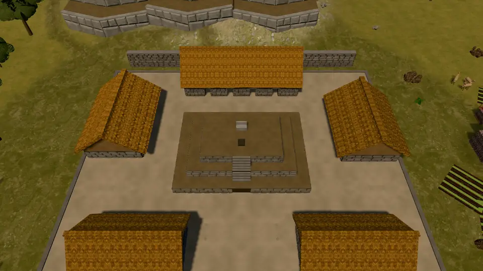
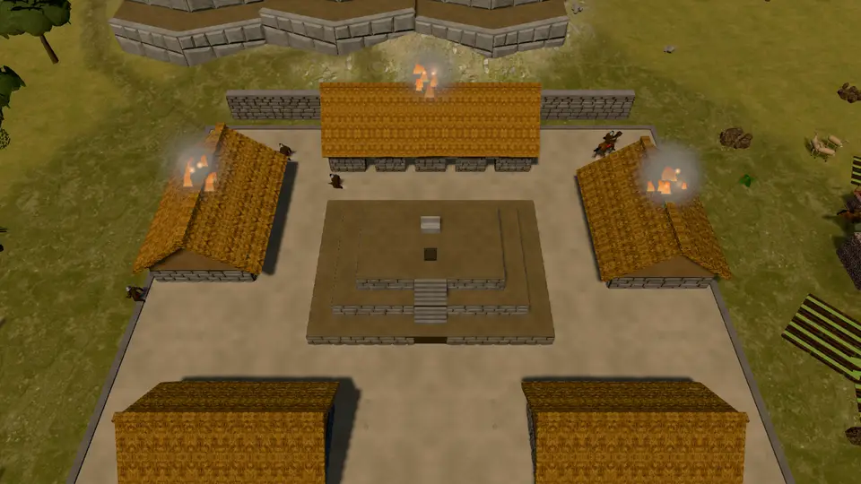

# 0011 — Mission fires derive from objective state

- **Status:** Proposed
- **Date:** 2026-11-27
- **Context:** Cusco 1536 and Vilcabamba describe a documented fire, but the missions had no way to show
  it. A one-shot trigger effect would duplicate the state the objective already holds and would need a new
  save field. A pure presentation effect would also have to be re-applied after loading.

## Decision

`MissionDef.fires` lists fires as `{ objectiveId, pos, count?, height? }`. `Mission.updateFires` emits fire and
smoke every 0.12 s at each point whose objective is `completed`. `height` lifts the flames over the terrain, so
a fire can sit on a roof (Cusco) or burn over the ground of a settlement the player builds (Vilcabamba);
without it the flames pool on the paving. The flames are presentation only: they
deal no damage and do not alter pathing, victory or defeat.

The state lives in the objective, so `MissionSave` needs no new field: a load restores the objective and
the fire comes back on the next tick.

The flame *body* is normal-blended: an additive flame desaturates to a white blob over a sunlit roof, which is
how the first pass read as a lamp. The embers keep the glow on the additive layer. Each body sprite is a
tapered, leaning silhouette drawn in the particle fragment shader, and a plume's particles are born across its
footprint and climb (`plume`, negative gravity): a shared spawn point and no rise turn any count into a single
round candle. `plume` is opt-in, so torches, hearths and burning buildings keep their existing look.

## Alternatives rejected

- **A one-shot `fire` trigger effect.** It would need its own fired/active flag and would not survive a
  load unless saved.
- **A saved fire list.** Duplicates the objective state and adds a migration for no gameplay gain.
- **Burning damage.** The documented fires are a backdrop to the siege, not a mechanic the player can
  fight; damage would change the mission balance and the AI's behaviour.

## Consequences

- Fires stop when the mission ends, like every other mission presentation tick.
- The same mechanism can light a fire for any objective, but each point is authored: no procedural spread.
  Cusco's points live with the kit (`CUSCO_CITY_FIRES`), so moving a house moves its fire.
- A future damage-bearing fire should be a new effect with its own save and replay decision, not a change
  to this one.
- `node scripts/capture_mission_fires.mjs --out=docs/media/cusco-fires` regenerates the evidence pair:

  
  

## Revisit

If a mission needs the player to extinguish or avoid a fire, this decision is insufficient; write a new
record for that mechanic.
