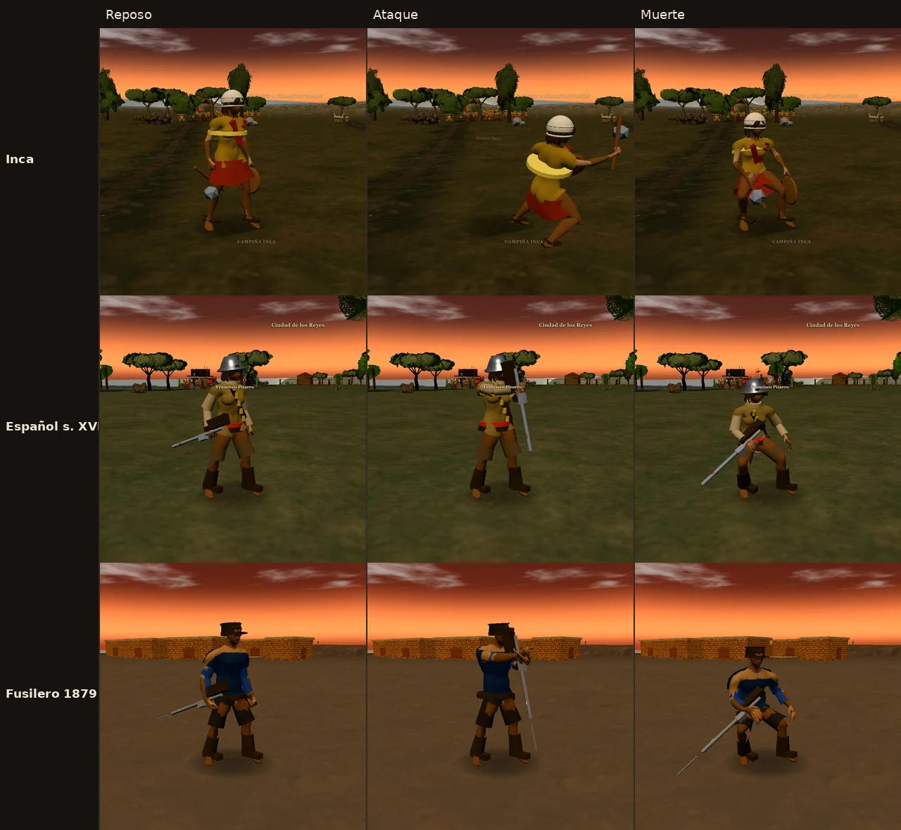
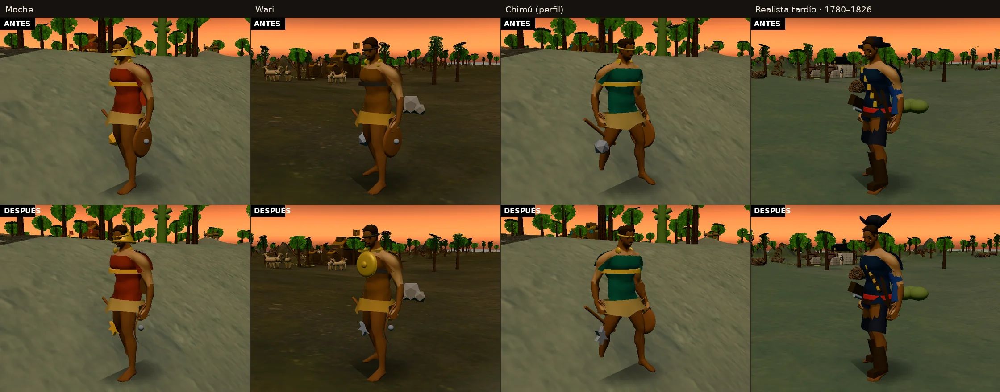
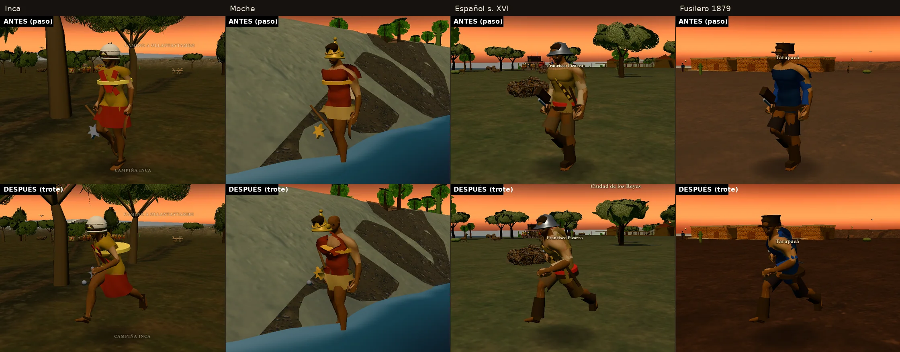
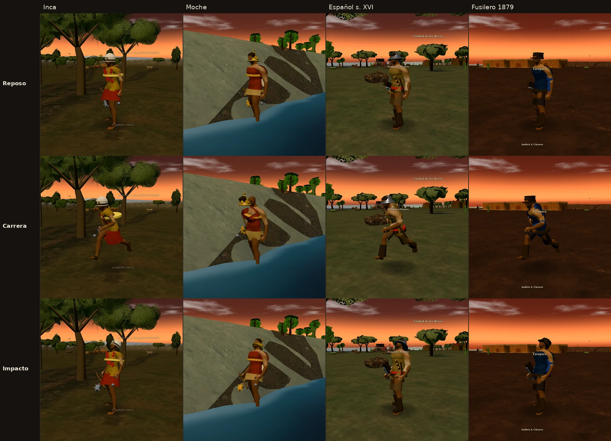

# Character visual pilot

**Status:** Living · **Date:** 2026-11-23 · **Branch:** `feat/character-visual-pilot` and
`feat/andean-equipment-standard`

The audit and performance numbers below are a **2026-11-23 snapshot**; update them when the rig,
equipment or budgets change.

This pilot raises the field appearance of three representative infantry units to the stylized-realism
standard of [`../design/art-direction.md`](../design/art-direction.md) §4.1. It audits the shared rig,
replaces the primitive period equipment with shaped garments and gear, keeps the proven skeleton and clips,
and measures the result against the project budgets. §8 extends the same standard to the documented Andean
warrior sets and to the late-colonial bicorn.

It is deliberately **not** a library-wide rebuild: a handful of cultures/periods are in scope. The historical
facts and their certainty stay in [`../historia/atuendos.md`](../historia/atuendos.md); this document does not
restate the dossiers.




## 1. Audit of the current system

The runtime source of truth is `src/model/defs/modelAssets.ts` and
`src/rendering/modelAssetRegistry.ts`. Every humanoid unit uses one asset, `caral_worker.glb`:

| Item | Measured |
| --- | --- |
| Skeleton | 65 bones, shared by every humanoid variant |
| Clips | 11: idle, walk, walk-carry, gather, build, jab, shoot, sword, throw, death, tree-chop |
| Geometry | 14,367 triangles, 10 materials, 15 meshes |
| File | 2.36 MiB, of which 1.53 MiB are four embedded PNG textures |
| Per-unit cost (bench baseline) | ~9.3k triangles and ~8–9 draw calls including the shadow pass |
| Budget | 40 draws / 40k triangles (bench); art-direction target 25 / 25k for a common unit |
| `dist/` | 27.61 MiB of 28 MiB; first-play payload 1.87 MiB gzip |

The mounted, siege and vehicle rigs are separate GLBs and were not changed; this pilot is infantry-only. The
art-direction camera distances are 28 (close), 54 (default) and max zoom; the captures validate close and
default.

The reusable system is sound: `ModelAssets` (cache, preload, fallback), `RigInstance` (independent skeleton
and mixer, crossfades, grounded feet), the variant table, `consolidateRig`, `limitShadowCasters` and the
`rigClipStateFor` state machine. None of that was replaced.

The real limitations were in the dressing layer:

- The post-1532 uniform added a **cylinder coat** over the body, a **cone** morion, a **box/cylinder** kepi,
  a flat shield and a box-headed macana. No sleeves, breeches, boots, bandolier, cartridge pouches or
  bayonet.
- The Inca soldier had a headband, a rodela and a porra, but no padded helmet, V yoke or sandals.
- The 16th-century Spanish soldier reused the 18th-century Bourbon blue/red abstract coat.
- Body proportions are still the CC0 ~8-head mannequin; the face is texture-only and the eyes are hidden.

## 2. The new-GLB attempt and why the pilot uses runtime equipment

The first implementation authored three new GLBs (`inca_infantry`, `spanish16_infantry`,
`republic1879_infantry`) by loading the finished worker, adding period garments/gear and re-exporting with
`GLTFExporter` + meshopt. The assets loaded and measured 0.55–0.64 MiB each, but **the shared skin broke**:

- At rest the body looked correct.
- As soon as `Idle_Loop` moved a bone, chest vertices were skinned to `y = 2.27–4.10` while the same bones
  stayed at `y = 1.27–1.52`. The body stretched into a pole; the tunic/skirt collapsed onto the head.
- The cause is the worker's meshopt-normalized geometry plus the shared inverse bind matrices. Re-exporting
  the body and adding new skinned meshes does not preserve the bind relationship for every mesh.
- Disabling quantization, rebaking the bind pose to world space and rebuilding the skeleton did not fix it
  within the pilot's budget. The exported skin still disagrees with the animation tracks.

The experiment was removed. The pilot therefore uses the project's existing, proven path: **runtime
bone attachments on the shared worker rig** (`workerAttire.ts`, `uniformAttire.ts`), which keeps the
skeleton, clips, save/replay determinism and fallback intact. This is a deliberate result of the audit, not
a shortcut: **re-exporting the finished worker GLB** is not safe. A source-based build (the
`tambotoco_hero.glb` path) remains viable, but extending it to three new bodies was outside this pilot's
budget.

## 3. The three units

| Unit | Unit kinds / variants | Mission used for validation | Why this unit |
| --- | --- | --- | --- |
| **Guerrero inca** | `INCA_WARRIOR` and Inca `SOLDIER` → `inca_soldier_*`; slinger → `inca_ranged_*` | `m_cusco_1536` (12 + Manco Inca), `m_vilcabamba`, allies in `m_lima` | The imperial infantry is the icon of the Tahuantinsuyo and appears in formation. |
| **Arcabucero, 1535–1572** | `MUSKETEER` and `SOLDIER` realistas with the morion → `realistas_soldier_*` / `realistas_ranged_*` | `m_lima` (3 arcabuceros + 8 soldiers; player is the Hueste indiana) | The conquest mission; the firearm and morion are the period signature. |
| **Fusilero / defensor, 1879** | `REPUBLICA_DEFENSOR` and `RIFLEMAN` → `republica_soldier_*` / `republica_ranged_*`; Chile shares the gear | `m_tarapaca` (8 defensores + 3 fusileros + Cáceres) | The War of the Pacific is the third distinct material language: wool, leather, steel and the kepi. |

`INCA_SLINGER` is pinned to the Andean rig, so the slinger also receives the Inca helmet/yoke but keeps
`sling`/`OverhandThrow`. The Ayar and the Killke/ayllu cultures stay on the old shared dressing.

## 4. Historical and visual references

The certainty table distinguishes documentation from reconstruction; no new historical claim is introduced.

| Element | Status | Basis |
| --- | --- | --- |
| Inca uncu, taparrabos, rodela, porra/macana, honda, padded protection | Documented | `atuendos.md` §1–2, §6 (Museo Larco, Métraux, LACMA/Dumbarton Oaks/Met) |
| Inca tocapu/checkerboard and red V yoke | Documented as a garment pattern; the exact layout is an abstraction | `atuendos.md` §1 |
| Inca quilted helmet, V yoke and usuta sandals | Plausible reconstruction | Padded protection is documented; the specific helmet/sandal shape is a game abstraction |
| 1879 Peruvian blue guerrera, kepi, rifle and bayonet | Documented | `atuendos.md` §4 (Guerra del Pacífico uniformology report) |
| 1878–79 Chilean blue coat, kepi, garance trousers | Documented | `atuendos.md` §4 (Chilean uniform decree, 1878) |
| 1535–1572 morion, doublet, breeches, boots, arquebus, sword | **Plausible reconstruction** | The repository has no 16th-century regimental uniform source; the blue/red table entry is 18th-century (Bourbon) |
| Exact regiment, buttons, facings and colours | Not claimed | Deliberately omitted |

Visual references are Age of Empires IV (readability at two camera distances, material honesty) and 0 A.D.
(civilization differentiation by silhouette). Only principles were studied; no model, texture or design was
copied. No external asset was downloaded or added.

## 5. Changes

### Inca (`src/rendering/workerAttire.ts`)

- Quilted cotton helmet (cap plus three bands) for soldiers and slingers.
- Red V yoke on the chest.
- Convex rodela with a stone boss instead of a flat cylinder.
- Slimmer wooden macana with a star/rosette stone head (the general Andean club-head shape; §8 later
  applied it to every Andean soldier).
- Usuta sandals (sole plus strap) per foot.
- The shared uncu/skirt/wrap keep their existing skinning and are tinted from the civilization palette.

### Spanish and Republican (`src/rendering/uniformAttire.ts`)

- The worker tunic is the coat/doublet; the extra cylinder coat was removed.
- Sleeves and collar cover the short-sleeved body.
- Breeches/trousers and boots/shoes on the leg bones.
- Proper lathe morion with comb; bicorn for the late realistas; kepi with crown, top, visor and band.
- Bandolier with five powder flasks; waist belt, cartridge belt, pouches and sash.
- Musket/rifle with barrel, stock, butt, lock, band and bayonet; sword for the melee role.
- The 1535–1572 Spanish variant uses buff wool and brown breeches instead of the Bourbon blue/red; the
  late realistas keep the blue coat.
- Gear is merged per bone into a few vertex-coloured draws; the static skinned body is consolidated.

### Tooling and tests

- `scripts/bench_character_pilot.mjs` (`yarn bench:characters`) measures the three units in their missions
  and asserts the common-unit ceiling.
- `tests/model-assets.test.ts` now checks the new attachment names (`attire_post_morion`, bicorn, sleeves,
  weapon) instead of the removed cylinder coat.
- The 1535–1572 kit is recorded here as a plausible reconstruction. `atuendos.md` documents the
  18th-century blue/red uniform and the 1879 uniforms; it has no 16th-century regimental source.

No gameplay, balance, combat, save or replay behaviour changed. No new dependency or asset was added.

## 6. Before and after

The contact sheet at the top compares the same three units, missions and camera setup:

| Unit | Before | After |
| --- | --- | --- |
| Inca | Headband, flat shield, box-headed club, bare feet | Padded helmet, red V yoke, convex rodela, stone macana, sandals |
| Spanish 1535–1572 | Blue cylinder coat, cone morion, bare feet | Buff coat with sleeves, breeches, boots, lathe morion, sash, bandolier, arquebus |
| Republican 1879 | Blue cylinder coat, plain kepi, bare feet | Blue coat with sleeves, kepi with visor, gaiters, cartridge belt, rifle and bayonet |

Committed captures: [`character-pilot-before-after.webp`](../media/character-pilot-before-after.webp),
[`character-pilot-lineup.webp`](../media/character-pilot-lineup.webp),
[`character-pilot-inca.webp`](../media/character-pilot-inca.webp),
[`character-pilot-spanish.webp`](../media/character-pilot-spanish.webp) and
[`character-pilot-republic.webp`](../media/character-pilot-republic.webp). The local full-resolution PNGs are
in `review/pilot/` and `review/pilot-before/` (gitignored). The captures use the mission opening with HUD
hidden, `low=1`, `fog=0`, fixed noon light, seed from the mission, a close three-quarter camera and the
unit's `idle` clip. This sheet is the **PR #609 snapshot** of the three-unit pilot; the current
`scripts/capture_character_pilot.mjs` captures the seven units of §8. The before/after rows of §8 are produced
by running that script with `--out=review/character-standard`, then `git checkout origin/main --
src/rendering/workerAttire.ts src/rendering/uniformAttire.ts` and the same command with
`--out=review/character-standard-before`, then restoring the branch files. At the default height 54 the unit
reads as a small silhouette and colour block; the equipment is a close/cinematic read.
The attack column uses the shared `Sword_Regular_A`/`Pistol_Shoot`/`OverhandThrow` clips and the death
column uses `Death01`; the firearm attack is the shared one-handed pistol clip, not a two-handed musket aim.
`run` and the hit reaction landed later, in §9.

## 7. Tests and performance

| Gate | Result |
| --- | --- |
| `yarn typecheck` | pass |
| `yarn lint` | pass, 0 warnings |
| `yarn format:check` | pass |
| `yarn test` | 129 files, 1,091 tests, pass |
| `yarn build` | pass |
| `yarn dist:check` | 27.61 MiB / 28 MiB; first play 1.88 MiB gzip; loader 2 KB gzip |
| `yarn bench:characters` | Inca 9 / 10.7k; Spanish 6 / 10.5k; Republican 6 / 9.5k; Moche 9 / 9.4k; Wari 9 / 10.1k; Chimú 9 / 9.1k; late realista 6 / 9.7k (draws / triangles) |

The measurement is the isolated unit cost (main + shadow pass) in its mission or skirmish, using the same
shown/hidden delta as the rig bench. `consolidateRig` merges the rigid bone-attached gear (morion, backplate,
breeches, boots, sleeves, sandals) into the same skinned draws as the body and the garments, and only the
body silhouette casts a shadow, so the numbers are 6–9 draws for every unit — the primitive-gear baseline was
~8–9 — and 9.1–10.7k triangles, below the 25k common-unit target. A 12-unit formation measures
108 / 72 / 72 / 108 / 108 / 108 / 72 draws and 0.13–0.14 ms/frame of mixer work; the previous
168 / 264 / 246 / 144 / 156 / 120 / 264 was the unmerged gear. Parts whose visibility changes at runtime (tool, net, carry bundle, weapon, and the pieces the hero
hides) deliberately keep their own draw: ~15 gear meshes per post-colonial soldier collapsed into three.

**LOD, instancing and memory.** The rig has no LOD or instancing: every unit owns a skeleton and mixer, while
geometry, materials and clips are shared by the asset cache. The pilot adds no game asset or texture, so GPU
memory and the 28 MiB `dist` budget are unchanged. A future LOD would need a non-skinned or impostor path,
not another skinned mesh.

## 8. Extension: Andean warriors and the late realistas

The same runtime standard was then applied to the remaining documented pre-Hispanic warrior sets and to the
late-colonial bicorn. Only elements the dossier already describes were shaped; cultures whose dossier says
«no documentado» keep the shared base and gain no invented garment.



| Culture / unit | Documented element | Runtime change | Certainty |
| --- | --- | --- | --- |
| **Moche** (`moche_soldier_*`) | conical metal helmet, trapezoidal backflap, ear spools, circular shield, star/rosette club heads | cone with a brow rim and a top knob; trapezoid back plate; flared ear spools; domed rodela with a boss; six-point star head | conical shape documented; the rim and top knob are game abstractions. The backflap is a contrasting textile panel |
| **Wari** (`wari_soldier_*`) | chest and back armour joined by the shoulders, pectoral disc, ear spools | domed chest disc with a rim and central boss, matching back plate and two shoulder straps, all outside the tunic | documented; the plate is modelled as a metal disc |
| **Chimú / Recuay** (`chimu_*`, `recuay_*`) | metal ear spools (Chimú also masks/tumi) | flared ear spools; the shared rodela and star macana | spools documented; **no garment is claimed** and the masks/tumi stay unmodelled, as the dossier already notes |
| **Chanca** (`chanca_*`) | face paint | unchanged | documented |
| **Late realistas / patriotas** (1780–1826) | bicorn | lens brim with upswept corners and a low crown, replacing the box brim + cylinder that read as a top hat | documented headwear; the exact crown is an abstraction |

The Moche backflap material is not documented. The dossier describes a «túnica con armadura de espalda»; the
game paints the plate in the civilization's secondary textile colour so it reads against the red tunic, without
claiming a leather or metal piece. The conical helmet's rim and top knob are likewise game abstractions on the documented shape.

The **shared** rodela and star/rosette macana apply to every Andean soldier (Inca, Chanca, Tiahuanaco, Nazca,
Chincha, Collas, Huanca, Killke/ayllus), so those silhouettes changed too even though their culture-specific
gear was not in this pass. The dossier documents disc/star/rosette heads and circular shields generally, so the
shape is not a new culture claim; §9.5 records the remaining review.

Reproduce the sheet with:

```sh
node scripts/capture_character_pilot.mjs --out=review/character-standard
git checkout origin/main -- src/rendering/workerAttire.ts src/rendering/uniformAttire.ts
node scripts/capture_character_pilot.mjs --out=review/character-standard-before
git checkout HEAD -- src/rendering/workerAttire.ts src/rendering/uniformAttire.ts
```

### Costs and testing

Per-unit cost is in the §7 table. All seven units are inside the 25-draw / 25k common-unit ceiling, and the
merged gear path (see §7) is what brought the post-colonial soldier from 22 draws to 6.

`tests/model-assets.test.ts` now covers the shaped bicorn (wider than deep) and the Moche trapezoid (wider at
the bottom); the existing Moche/Wari/Chimú E2E specs keep asserting the documented gear names.
`scripts/bench_character_pilot.mjs` and `scripts/capture_character_pilot.mjs` cover the seven units.

## 9. Animation pass: run and hit reaction





The shared worker had no jog and no hit reaction, so a charging soldier and a running scout both replayed the
walk, and damage had no pose. Both clips are CC0 UAL1 clips already used by the project; they are added at
**build time** in `scripts/build_caral_worker.mjs` (not by re-exporting the finished GLB), so the skin, the
skeleton and the bind matrices are untouched:

- `Jog_Fwd_Loop` (~0.93 s worker / 0.92 s hero) and `Hit_Chest` (0.33 s) are appended to the worker and the
  hero GLBs.
- `run: 'Jog_Fwd_Loop'` is registered for `caral_worker` and `tambotoco_hero`; `UnitView` already asked the rig
  for `run` when a unit charges or exceeds the speed threshold, so scouts and charging infantry now jog.
- `Hit_Chest` plays as a **presentation-only overlay**: `Unit.takeDamage` sets a 0.3 s `hitReact` timer,
  `UnitView` calls `RigInstance.playHit()`, and the rig restarts the latest requested state when the clip ends
  (the resume calls `play()`, not only `fadeIn()`, so a state requested during the flinch actually starts).
  A 0.6 s cooldown stops a burst of damage from restarting the flinch; the timer is not serialized and cannot
  affect the simulation, replay determinism or balance.
- `build_caral_worker.mjs` now records the two clips in its clip list and the hero filter (4 → 6 clips).

### Costs

| Gate | Result |
| --- | --- |
| `caral_worker.glb` | 2.36 → 2.45 MiB (2 clips) |
| `tambotoco_hero.glb` | 1.38 → 1.48 MiB (2 clips) |
| `dist` | 27.61 → 27.80 MB (limit 28 MB, 1024-based; ~0.20 MB headroom); first play 1.88 MB gzip |
| Unit cost | unchanged (the clips do not add draws or triangles) |

The `run` reference speed is a stylized 3.0 m/s (`runReferenceSpeed`), not a measured gait; at a 5.4 m/s scout
the clip plays near 1.5–1.8× instead of the 2.2× clamp and the feet slide less.

`tests/model-assets.test.ts` checks the worker's `Jog_Fwd_Loop`/`Hit_Chest` durations and that a state requested
during the flinch really starts (the thigh bone keeps moving after the resume).
`tests/e2e/caral-worker.spec.ts` damages a worker, checks the hp loss and that the overlay starts and clears;
the Caral and Inca scout specs now expect `run`/`Jog_Fwd_Loop` for a moving scout, which is the intended
behaviour change. `yarn test` (1,092 tests) and `yarn test:e2e:fast` (349 tests) are green.

## 10. Body proportions


The pilot left the shared CC0 body at ~8 heads. The hero already had a baked proportion pass
(`bake_character_proportions.py`: head and hands +12 % around their bone pivots, shoulders/waist taper); the
worker now gets the same pass **inside `build_caral_worker.mjs`**, before the tunic is derived from the body,
so every humanoid variant shares the new silhouette.

| Measure | Before | After |
| --- | --- | --- |
| `Body_f` head/body | 7.77 heads | 7.04 heads |
| `Body_m` head/body | 7.94 heads | 7.21 heads |
| Head/hand scale | 1.00 | 1.12 around the bone pivots |
| `caral_worker.glb` | 2,571,908 bytes | 2,572,416 bytes |
| `dist` | 27.80 MB | 27.80 MB (1024-based) |

The ratio is measured on the dominant-`Head` vertices against the body bbox in the bind pose; the absolute
head height depends on which vertices are counted, so the table uses the ratio the art direction specifies.
The taper is a global x scale in the pelvis–head band (it also nudges the arms slightly), the same pass the
hero already had.

The pass is applied in the browser build rather than a Blender round-trip: importing/exporting the worker
through Blender splits its welded vertices and grew the shared GLB by ~0.17 MB (`dist` reached 27.96 MB), while
the browser pass adds ~0.5 KB. The hero keeps the Blender authoring path because it is a separate asset.

**Remaining gap.** ~7.0–7.2 heads is inside the 6.5–7 band only at the edge; a true 6.5–7-head character needs
a body-specific sculpt/retopology, not another uniform scale. The face is still the painted source texture: no
geometric nose, jaw or eyelids. The **mounted rider** is a separate procedural Blender rig
(`build_mounted_rig.py`) and keeps ~8 heads; it is a follow-up, not part of this pass.
`tests/visual/baseline.json` was regenerated for the 26 affected scenes with `yarn visual:update` on the
authoring host; the wide region/landscape scenes also carry capture drift, which is why the diff is larger than
the silhouette change alone.

## 11. Pending issues

1. **Body and face.** §10 took the shared body from ~8 to ~7.1 heads with the baked head/hand scale and waist
   taper, so the face and hands read better. It is still a uniform scale on the CC0 body, not a body-specific
   sculpt: 6.5–7 heads, a geometric nose/jaw and eyelids remain open.
2. **Bind-matrix-safe GLB export.** Re-exporting the finished worker GLB remains blocked by the shared-skeleton
   problem in §2. A future body replacement should start from the original Quaternius sources (the
   `tambotoco_hero.glb` path) or prove that its export preserves the inverse bind matrices and tracks.
3. **Two-handed firearm aim.** §9 added `run` and the hit reaction. The firearm attack is still the shared
   one-handed `Pistol_Shoot`, not a two-handed musket/rifle aim; UAL1 has `Pistol_Aim_*` poses, but wiring a
   two-handed aim/recoil state is a separate animation change.
4. **Rigid cloth at joints.** Sleeves and breeches are rigid bone attachments; deep poses can show a crease
   at the elbow/knee. At the RTS camera it is not visible; a skinned garment needs the bind-safe path.
5. **Shared dressers.** `dressUniform` serves every post-colonial variant and `dressCaralWorker` every Andean
   one. The shaped gear now reaches the Moche, Wari, Recuay, Chimú, late realistas and patriotas. The other
   Andean cultures inherit the shared rodela and star macana but not their own culture-specific gear, and the
   m7 rebels and modern roles are still unreviewed; the captures cover seven units, not every variant. Where
   the dossier says «no documentado», the shared base stays and no garment is invented.
6. **Draw-call headroom.** Every unit now measures 6–9 draws, so a third accessory per bone is not a draw-call
   risk. Keep new gear on `attach()` and add its name to the attire's `dynamic` list only if it toggles
   visibility, or it will be merged into the shared draw.

## 12. Recommendation

**The runtime equipment standard is worth keeping and extending, but it is not yet a complete character
standard.**

- The standard now covers seven units (Inca, 16th-century Spanish, 1879 Republican/Chilean, Moche, Wari,
  Chimú/Recuay and the late realista) with documented, shaped gear, `run` and a hit reaction on the shared
  rig, and every gate green. Extend the rest of the infantry culture by culture with the
  `yarn bench:characters` ceiling, and stop wherever the dossier says «no documentado» instead of inventing a
  garment.
- §10 landed the proportion pass (~7.1 heads, bigger head/hands). The next real quality step is the body
  itself: a 6.5–7-head sculpt/retopology with a geometric nose/jaw and eyelids. Uniform scaling has reached
  its limit; no amount of gear will change that.
- Keep the shared `caral_worker` body and clips for now. A new body must come with a bind-safe GLB export
  and a before/after that proves the animation did not stretch.
- The 28 MiB budget is untouched because the gear is runtime geometry; that is the strongest argument for the
  runtime path until the export problem is solved.
- New headwear or a cuirass can go straight onto `attach()`: `consolidateRig` now merges the static gear into
  the shared skinned draws, so a unit costs 8–9 draws with or without it (list it in `dynamic` only if it
  toggles visibility).

## See also

[`../design/art-direction.md`](../design/art-direction.md) §4.1 ·
[`../design/characters.md`](../design/characters.md) ·
[`../historia/atuendos.md`](../historia/atuendos.md) ·
[`../design/visual-language.md`](../design/visual-language.md) ·
[`../design/asset-pipeline.md`](../design/asset-pipeline.md)
