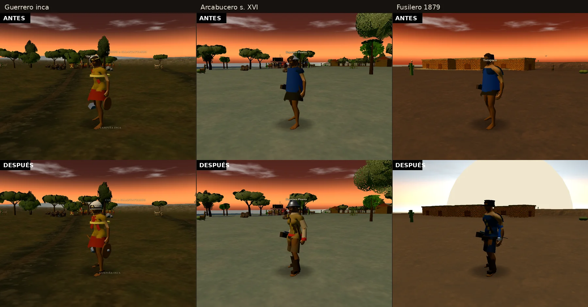
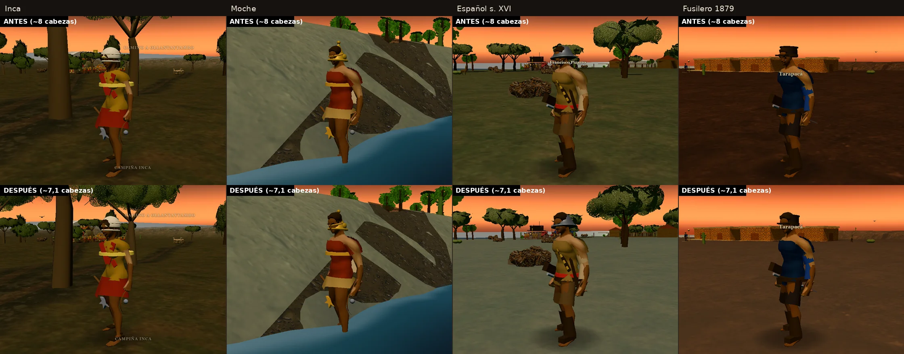
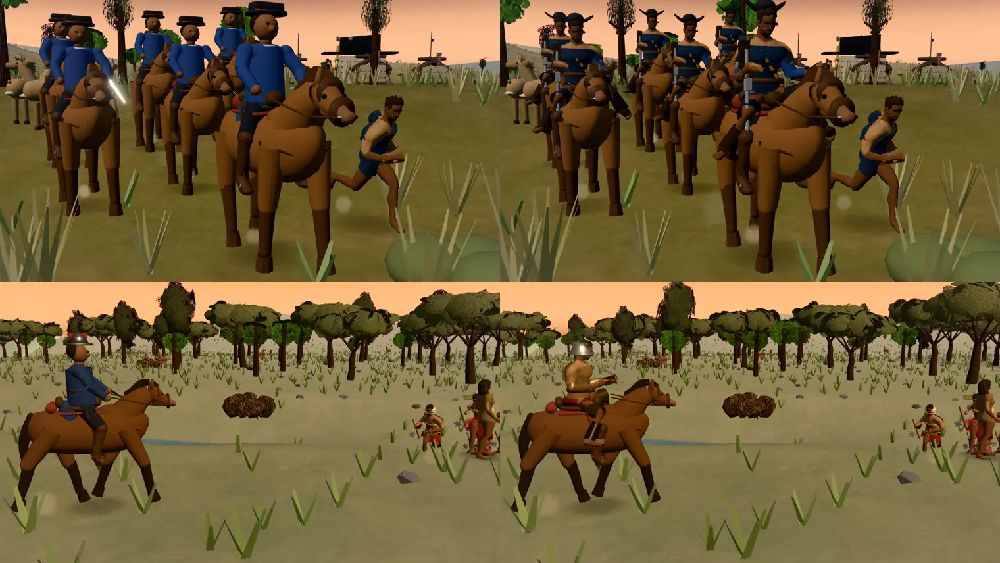
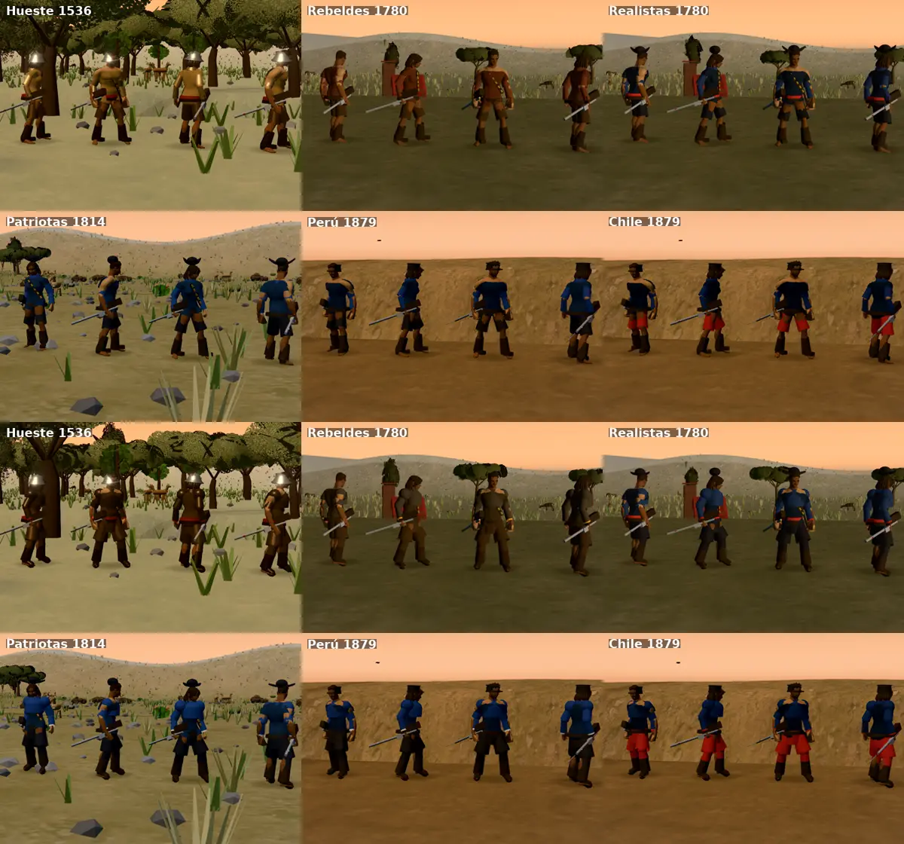
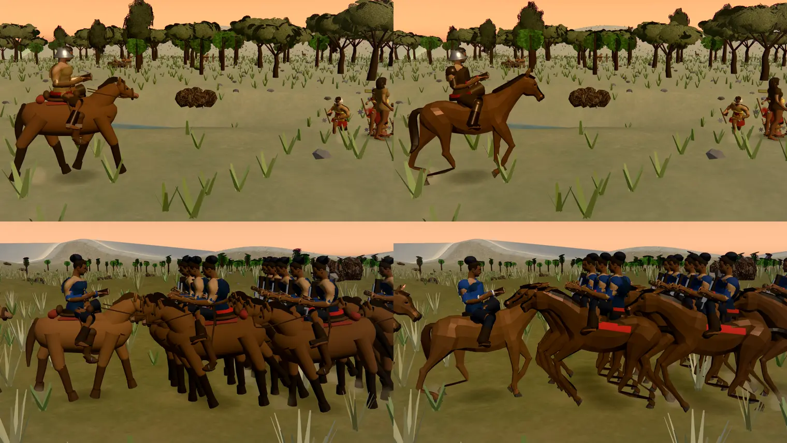
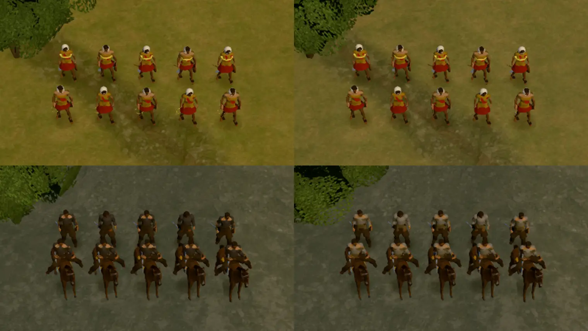
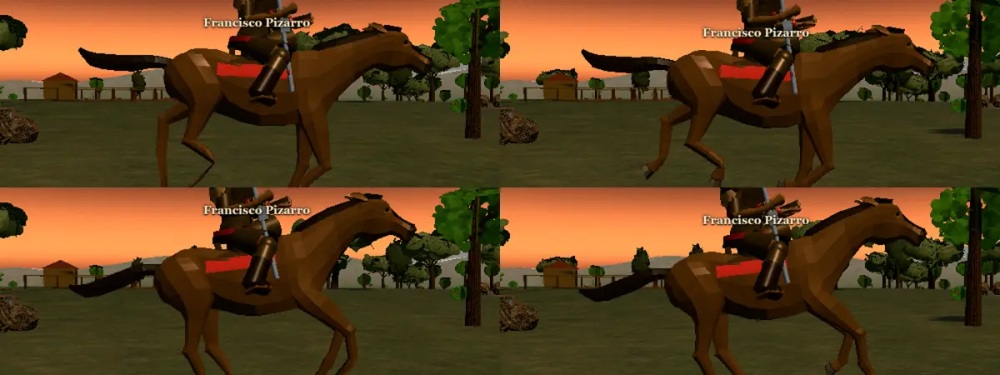
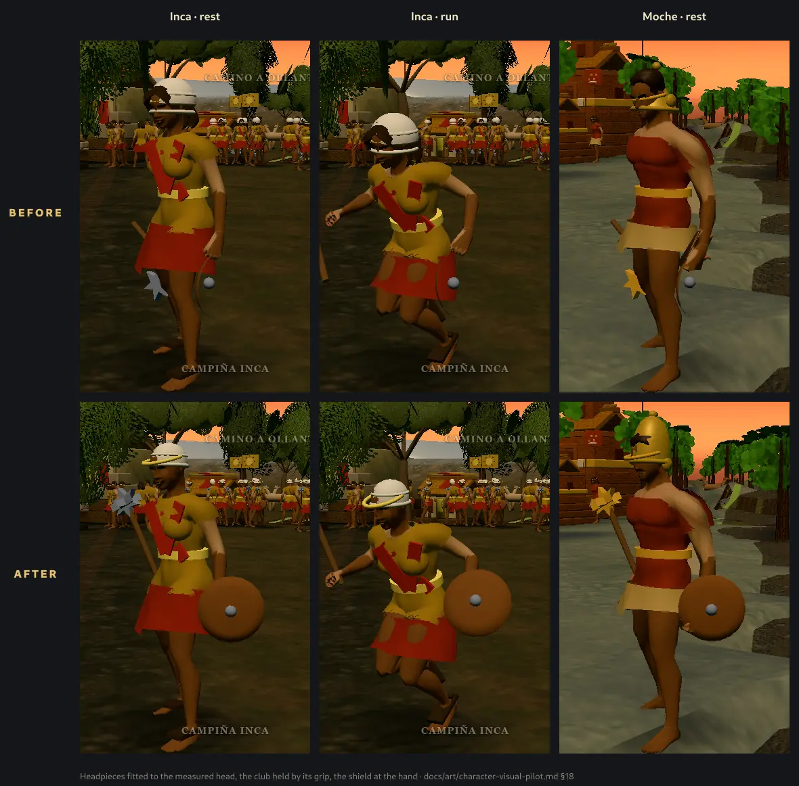
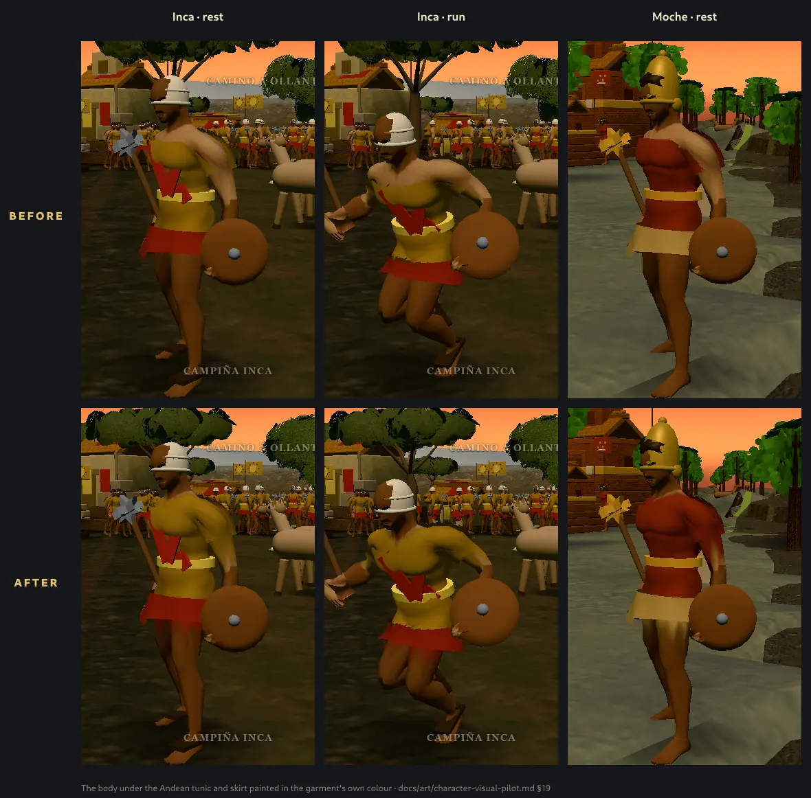

# Character visual pilot

**Status:** Living · **Date:** 2026-11-23 · **Branch:** `feat/character-visual-pilot` and
`feat/andean-equipment-standard`

The audit and performance numbers below are a **2026-11-23 snapshot**; update them when the rig,
equipment or budgets change.

This pilot raises the field appearance of three representative infantry units to the stylized-realism
standard of [`../design/art-direction.md`](../design/art-direction.md) §4.1. It audits the shared rig,
replaces the primitive period equipment with shaped garments and gear, keeps the proven skeleton and clips,
and measures the result against the project budgets. §8 extends the same standard to the documented Andean
warrior sets and to the late-colonial bicorn.

It is deliberately **not** a library-wide rebuild: a handful of cultures/periods are in scope. The historical
facts and their certainty stay in [`../historia/atuendos.md`](../historia/atuendos.md); this document does not
restate the dossiers.




## 1. Audit of the current system

The runtime source of truth is `src/model/defs/modelAssets.ts` and
`src/rendering/modelAssetRegistry.ts`. Every humanoid unit uses one asset, `caral_worker.glb`:

| Item                           | Measured                                                                              |
| ------------------------------ | ------------------------------------------------------------------------------------- |
| Skeleton                       | 65 bones, shared by every humanoid variant                                            |
| Clips                          | 11: idle, walk, walk-carry, gather, build, jab, shoot, sword, throw, death, tree-chop |
| Geometry                       | 14,367 triangles, 10 materials, 15 meshes                                             |
| File                           | 2.36 MiB, of which 1.53 MiB are four embedded PNG textures                            |
| Per-unit cost (bench baseline) | ~9.3k triangles and ~8–9 draw calls including the shadow pass                         |
| Budget                         | 40 draws / 40k triangles (bench); art-direction target 25 / 25k for a common unit     |
| `dist/`                        | 27.61 MiB of 28 MiB; first-play payload 1.87 MiB gzip                                 |

The mounted, siege and vehicle rigs are separate GLBs and were not changed; this pilot is infantry-only. The
art-direction camera distances are 28 (close), 54 (default) and max zoom; the captures validate close and
default.

The reusable system is sound: `ModelAssets` (cache, preload, fallback), `RigInstance` (independent skeleton
and mixer, crossfades, grounded feet), the variant table, `consolidateRig`, `limitShadowCasters` and the
`rigClipStateFor` state machine. None of that was replaced.

The real limitations were in the dressing layer:

- The post-1532 uniform added a **cylinder coat** over the body, a **cone** morion, a **box/cylinder** kepi,
  a flat shield and a box-headed macana. No sleeves, breeches, boots, bandolier, cartridge pouches or
  bayonet.
- The Inca soldier had a headband, a rodela and a porra, but no padded helmet, V yoke or sandals.
- The 16th-century Spanish soldier reused the 18th-century Bourbon blue/red abstract coat.
- Body proportions are still the CC0 ~8-head mannequin; the face is texture-only and the eyes are hidden.

## 2. The new-GLB attempt and why the pilot uses runtime equipment

The first implementation authored three new GLBs (`inca_infantry`, `spanish16_infantry`,
`republic1879_infantry`) by loading the finished worker, adding period garments/gear and re-exporting with
`GLTFExporter` + meshopt. The assets loaded and measured 0.55–0.64 MiB each, but **the shared skin broke**:

- At rest the body looked correct.
- As soon as `Idle_Loop` moved a bone, chest vertices were skinned to `y = 2.27–4.10` while the same bones
  stayed at `y = 1.27–1.52`. The body stretched into a pole; the tunic/skirt collapsed onto the head.
- The cause is the worker's meshopt-normalized geometry plus the shared inverse bind matrices. Re-exporting
  the body and adding new skinned meshes does not preserve the bind relationship for every mesh.
- Disabling quantization, rebaking the bind pose to world space and rebuilding the skeleton did not fix it
  within the pilot's budget. The exported skin still disagrees with the animation tracks.

The experiment was removed. The pilot therefore uses the project's existing, proven path: **runtime
bone attachments on the shared worker rig** (`workerAttire.ts`, `uniformAttire.ts`), which keeps the
skeleton, clips, save/replay determinism and fallback intact. This is a deliberate result of the audit, not
a shortcut: **re-exporting the finished worker GLB** is not safe. A source-based build (the
`tambotoco_hero.glb` path) remains viable, but extending it to three new bodies was outside this pilot's
budget.

## 3. The three units

| Unit                          | Unit kinds / variants                                                                                     | Mission used for validation                                          | Why this unit                                                                                      |
| ----------------------------- | --------------------------------------------------------------------------------------------------------- | -------------------------------------------------------------------- | -------------------------------------------------------------------------------------------------- |
| **Guerrero inca**             | `INCA_WARRIOR` and Inca `SOLDIER` → `inca_soldier_*`; slinger → `inca_ranged_*`                           | `m_cusco_1536` (12 + Manco Inca), `m_vilcabamba`, allies in `m_lima` | The imperial infantry is the icon of the Tahuantinsuyo and appears in formation.                   |
| **Arcabucero, 1535–1572**     | `MUSKETEER` and `SOLDIER` realistas with the morion → `realistas_soldier_*` / `realistas_ranged_*`        | `m_lima` (3 arcabuceros + 8 soldiers; player is the Hueste indiana)  | The conquest mission; the firearm and morion are the period signature.                             |
| **Fusilero / defensor, 1879** | `REPUBLICA_DEFENSOR` and `RIFLEMAN` → `republica_soldier_*` / `republica_ranged_*`; Chile shares the gear | `m_tarapaca` (8 defensores + 3 fusileros + Cáceres)                  | The War of the Pacific is the third distinct material language: wool, leather, steel and the kepi. |

`INCA_SLINGER` is pinned to the Andean rig, so the slinger also receives the Inca helmet/yoke but keeps
`sling`/`OverhandThrow`. The Ayar and the Killke/ayllu cultures stay on the old shared dressing.

## 4. Historical and visual references

The certainty table distinguishes documentation from reconstruction; no new historical claim is introduced.

| Element                                                               | Status                                                              | Basis                                                                                                            |
| --------------------------------------------------------------------- | ------------------------------------------------------------------- | ---------------------------------------------------------------------------------------------------------------- |
| Inca uncu, taparrabos, rodela, porra/macana, honda, padded protection | Documented                                                          | `atuendos.md` §1–2, §6 (Museo Larco, Métraux, LACMA/Dumbarton Oaks/Met)                                          |
| Inca tocapu/checkerboard and red V yoke                               | Documented as a garment pattern; the exact layout is an abstraction | `atuendos.md` §1                                                                                                 |
| Inca quilted helmet, V yoke and usuta sandals                         | Plausible reconstruction                                            | Padded protection is documented; the specific helmet/sandal shape is a game abstraction                          |
| 1879 Peruvian blue guerrera, kepi, rifle and bayonet                  | Documented                                                          | `atuendos.md` §4 (Guerra del Pacífico uniformology report)                                                       |
| 1878–79 Chilean blue coat, kepi, garance trousers                     | Documented                                                          | `atuendos.md` §4 (Chilean uniform decree, 1878)                                                                  |
| 1535–1572 morion, doublet, breeches, boots, arquebus, sword           | **Plausible reconstruction**                                        | The repository has no 16th-century regimental uniform source; the blue/red table entry is 18th-century (Bourbon) |
| Exact regiment, buttons, facings and colours                          | Not claimed                                                         | Deliberately omitted                                                                                             |

Visual references are Age of Empires IV (readability at two camera distances, material honesty) and 0 A.D.
(civilization differentiation by silhouette). Only principles were studied; no model, texture or design was
copied. No external asset was downloaded or added.

## 5. Changes

### Inca (`src/rendering/workerAttire.ts`)

- Quilted cotton helmet (cap plus three bands) for soldiers and slingers.
- Red V yoke on the chest.
- Convex rodela with a stone boss instead of a flat cylinder.
- Slimmer wooden macana with a star/rosette stone head (the general Andean club-head shape; §8 later
  applied it to every Andean soldier).
- Usuta sandals (sole plus strap) per foot.
- The shared uncu/skirt/wrap keep their existing skinning and are tinted from the civilization palette.
- The uncu is sleeveless: the body paint covers only the shoulder cap, and the skirt paint stops above the
  local hem, so no cloth band runs down the bare thigh.

### Spanish and Republican (`src/rendering/uniformAttire.ts`)

- The worker tunic is the coat/doublet; the extra cylinder coat was removed.
- Sleeves and collar cover the short-sleeved body.
- Breeches/trousers and boots/shoes on the leg bones.
- Proper lathe morion with comb; bicorn for the late realistas; kepi with crown, top, visor and band.
- Bandolier with five powder flasks; waist belt, cartridge belt, pouches and sash.
- Musket/rifle with barrel, stock, butt, lock, band and bayonet; sword for the melee role.
- The 1535–1572 Spanish variant uses buff wool and brown breeches instead of the Bourbon blue/red; the
  late realistas keep the blue coat.
- Gear is merged per bone into a few vertex-coloured draws; the static skinned body is consolidated.

### Tooling and tests

- `scripts/bench_character_pilot.mjs` (`yarn bench:characters`) measures the three units in their missions
  and asserts the common-unit ceiling.
- `tests/model-assets.test.ts` now checks the new attachment names (`attire_post_morion`, bicorn, sleeves,
  weapon) instead of the removed cylinder coat.
- The 1535–1572 kit is recorded here as a plausible reconstruction. `atuendos.md` documents the
  18th-century blue/red uniform and the 1879 uniforms; it has no 16th-century regimental source.

No gameplay, balance, combat, save or replay behaviour changed. No new dependency or asset was added.

## 6. Before and after

The contact sheet at the top compares the same three units, missions and camera setup:

| Unit              | Before                                            | After                                                                               |
| ----------------- | ------------------------------------------------- | ----------------------------------------------------------------------------------- |
| Inca              | Headband, flat shield, box-headed club, bare feet | Padded helmet, red V yoke, convex rodela, stone macana, sandals                     |
| Spanish 1535–1572 | Blue cylinder coat, cone morion, bare feet        | Buff coat with sleeves, breeches, boots, lathe morion, sash, bandolier, arquebus    |
| Republican 1879   | Blue cylinder coat, plain kepi, bare feet         | Blue coat with sleeves, kepi with visor, gaiters, cartridge belt, rifle and bayonet |

Committed captures: [`character-pilot-before-after.webp`](../media/character-pilot-before-after.webp),
[`character-pilot-lineup.webp`](../media/character-pilot-lineup.webp),
[`character-pilot-inca.webp`](../media/character-pilot-inca.webp),
[`character-pilot-spanish.webp`](../media/character-pilot-spanish.webp) and
[`character-pilot-republic.webp`](../media/character-pilot-republic.webp). The local full-resolution PNGs are
in `review/pilot/` and `review/pilot-before/` (gitignored). The captures use the mission opening with HUD
hidden, `low=1`, `fog=0`, fixed noon light, seed from the mission, a close three-quarter camera and the
unit's `idle` clip. This sheet is the **PR #609 snapshot** of the three-unit pilot; the current
`scripts/capture_character_pilot.mjs` captures the seven units of §8. The before/after rows of §8 are produced
by running that script with `--out=review/character-standard`, then `git checkout origin/main --
src/rendering/workerAttire.ts src/rendering/uniformAttire.ts` and the same command with
`--out=review/character-standard-before`, then restoring the branch files. At the default height 54 the unit
reads as a small silhouette and colour block; the equipment is a close/cinematic read.
The attack column uses the shared `Sword_Regular_A`/`Pistol_Shoot`/`OverhandThrow` clips and the death
column uses `Death01`; the firearm attack is the shared one-handed pistol clip, not a two-handed musket aim.
`run` and the hit reaction landed later, in §9.

## 7. Tests and performance

| Gate                    | Result                                                                                                                                             |
| ----------------------- | -------------------------------------------------------------------------------------------------------------------------------------------------- |
| `yarn typecheck`        | pass                                                                                                                                               |
| `yarn lint`             | pass, 0 warnings                                                                                                                                   |
| `yarn format:check`     | pass                                                                                                                                               |
| `yarn test`             | 129 files, 1,091 tests, pass                                                                                                                       |
| `yarn build`            | pass                                                                                                                                               |
| `yarn dist:check`       | 27.61 MiB / 28 MiB; first play 1.88 MiB gzip; loader 2 KB gzip                                                                                     |
| `yarn bench:characters` | Inca 9 / 10.7k; Spanish 6 / 10.5k; Republican 6 / 9.5k; Moche 9 / 9.4k; Wari 9 / 10.1k; Chimú 9 / 9.1k; late realista 6 / 9.7k (draws / triangles) |

The measurement is the isolated unit cost (main + shadow pass) in its mission or skirmish, using the same
shown/hidden delta as the rig bench. `consolidateRig` merges the rigid bone-attached gear (morion, backplate,
breeches, boots, sleeves, sandals) into the same skinned draws as the body and the garments, and only the
body silhouette casts a shadow, so the numbers are 6–9 draws for every unit — the primitive-gear baseline was
~8–9 — and 9.1–10.7k triangles, below the 25k common-unit target. A 12-unit formation measures
108 / 72 / 72 / 108 / 108 / 108 / 72 draws and 0.13–0.14 ms/frame of mixer work; the previous
168 / 264 / 246 / 144 / 156 / 120 / 264 was the unmerged gear. Parts whose visibility changes at runtime (tool, net, carry bundle, weapon, and the pieces the hero
hides) deliberately keep their own draw: ~15 gear meshes per post-colonial soldier collapsed into three.

**LOD, instancing and memory.** The rig has no LOD or instancing: every unit owns a skeleton and mixer, while
geometry, materials and clips are shared by the asset cache. The pilot adds no game asset or texture, so GPU
memory and the 28 MiB `dist` budget are unchanged. A future LOD would need a non-skinned or impostor path,
not another skinned mesh.

## 8. Extension: Andean warriors and the late realistas

The same runtime standard was then applied to the remaining documented pre-Hispanic warrior sets and to the
late-colonial bicorn. Only elements the dossier already describes were shaped; cultures whose dossier says
«no documentado» keep the shared base and gain no invented garment.


| Culture / unit                             | Documented element                                                                               | Runtime change                                                                                                              | Certainty                                                                                                         |
| ------------------------------------------ | ------------------------------------------------------------------------------------------------ | --------------------------------------------------------------------------------------------------------------------------- | ----------------------------------------------------------------------------------------------------------------- |
| **Moche** (`moche_soldier_*`)              | conical metal helmet, trapezoidal backflap, ear spools, circular shield, star/rosette club heads | cone with a brow rim and a top knob; trapezoid back plate; flared ear spools; domed rodela with a boss; six-point star head | conical shape documented; the rim and top knob are game abstractions. The backflap is a contrasting textile panel |
| **Wari** (`wari_soldier_*`)                | chest and back armour joined by the shoulders, pectoral disc, ear spools                         | domed chest disc with a rim and central boss, matching back plate and two shoulder straps, all outside the tunic            | documented; the plate is modelled as a metal disc                                                                 |
| **Chimú / Recuay** (`chimu_*`, `recuay_*`) | metal ear spools (Chimú also masks/tumi)                                                         | flared ear spools; the shared rodela and star macana                                                                        | spools documented; **no garment is claimed** and the masks/tumi stay unmodelled, as the dossier already notes     |
| **Chanca** (`chanca_*`)                    | face paint                                                                                       | unchanged                                                                                                                   | documented                                                                                                        |
| **Late realistas / patriotas** (1780–1826) | bicorn                                                                                           | lens brim with upswept corners and a low crown, replacing the box brim + cylinder that read as a top hat                    | documented headwear; the exact crown is an abstraction                                                            |

The Moche backflap material is not documented. The dossier describes a «túnica con armadura de espalda»; the
game paints the plate in the civilization's secondary textile colour so it reads against the red tunic, without
claiming a leather or metal piece. The conical helmet's rim and top knob are likewise game abstractions on the documented shape.

The **shared** rodela and star/rosette macana apply to every Andean soldier (Inca, Chanca, Tiahuanaco, Nazca,
Chincha, Collas, Huanca, Killke/ayllus), so those silhouettes changed too even though their culture-specific
gear was not in this pass. The dossier documents disc/star/rosette heads and circular shields generally, so the
shape is not a new culture claim; §9.5 records the remaining review.

Reproduce the sheet with:

```sh
node scripts/capture_character_pilot.mjs --out=review/character-standard
git checkout origin/main -- src/rendering/workerAttire.ts src/rendering/uniformAttire.ts
node scripts/capture_character_pilot.mjs --out=review/character-standard-before
git checkout HEAD -- src/rendering/workerAttire.ts src/rendering/uniformAttire.ts
```

### Costs and testing

Per-unit cost is in the §7 table. All seven units are inside the 25-draw / 25k common-unit ceiling, and the
merged gear path (see §7) is what brought the post-colonial soldier from 22 draws to 6.

`tests/model-assets.test.ts` now covers the shaped bicorn (wider than deep) and the Moche trapezoid (wider at
the bottom); the existing Moche/Wari/Chimú E2E specs keep asserting the documented gear names.
`scripts/bench_character_pilot.mjs` and `scripts/capture_character_pilot.mjs` cover the seven units.

## 9. Animation pass: run and hit reaction


The shared worker had no jog and no hit reaction, so a charging soldier and a running scout both replayed the
walk, and damage had no pose. Both clips are CC0 UAL1 clips already used by the project; they are added at
**build time** in `scripts/build_caral_worker.mjs` (not by re-exporting the finished GLB), so the skin, the
skeleton and the bind matrices are untouched:

- `Jog_Fwd_Loop` (~0.93 s worker / 0.92 s hero) and `Hit_Chest` (0.33 s) are appended to the worker and the
  hero GLBs.
- `run: 'Jog_Fwd_Loop'` is registered for `caral_worker` and `tambotoco_hero`; `UnitView` already asked the rig
  for `run` when a unit charges or exceeds the speed threshold, so scouts and charging infantry now jog.
- `Hit_Chest` plays as a **presentation-only overlay**: `Unit.takeDamage` sets a 0.3 s `hitReact` timer,
  `UnitView` calls `RigInstance.playHit()`, and the rig restarts the latest requested state when the clip ends
  (the resume calls `play()`, not only `fadeIn()`, so a state requested during the flinch actually starts).
  A 0.6 s cooldown stops a burst of damage from restarting the flinch; the timer is not serialized and cannot
  affect the simulation, replay determinism or balance.
- `build_caral_worker.mjs` now records the two clips in its clip list and the hero filter (4 → 6 clips).

### Costs

| Gate                 | Result                                                                                 |
| -------------------- | -------------------------------------------------------------------------------------- |
| `caral_worker.glb`   | 2.36 → 2.45 MiB (2 clips)                                                              |
| `tambotoco_hero.glb` | 1.38 → 1.48 MiB (2 clips)                                                              |
| `dist`               | 27.61 → 27.80 MB (limit 28 MB, 1024-based; ~0.20 MB headroom); first play 1.88 MB gzip |
| Unit cost            | unchanged (the clips do not add draws or triangles)                                    |

The `run` reference speed is a stylized 3.0 m/s (`runReferenceSpeed`), not a measured gait; at a 5.4 m/s scout
the clip plays near 1.5–1.8× instead of the 2.2× clamp and the feet slide less.

`tests/model-assets.test.ts` checks the worker's `Jog_Fwd_Loop`/`Hit_Chest` durations and that a state requested
during the flinch really starts (the thigh bone keeps moving after the resume).
`tests/e2e/caral-worker.spec.ts` damages a worker, checks the hp loss and that the overlay starts and clears;
the Caral and Inca scout specs now expect `run`/`Jog_Fwd_Loop` for a moving scout, which is the intended
behaviour change. `yarn test` (1,092 tests) and `yarn test:e2e:fast` (349 tests) are green.

## 10. Body proportions



The pilot left the shared CC0 body at ~8 heads. The hero already had a baked proportion pass
(`bake_character_proportions.py`: head and hands +12 % around their bone pivots, shoulders/waist taper); the
worker now gets the same pass **inside `build_caral_worker.mjs`**, before the tunic is derived from the body,
so every humanoid variant shares the new silhouette.

| Measure            | Before          | After                       |
| ------------------ | --------------- | --------------------------- |
| `Body_f` head/body | 7.77 heads      | 7.04 heads                  |
| `Body_m` head/body | 7.94 heads      | 7.21 heads                  |
| Head/hand scale    | 1.00            | 1.12 around the bone pivots |
| `caral_worker.glb` | 2,571,908 bytes | 2,572,416 bytes             |
| `dist`             | 27.80 MB        | 27.80 MB (1024-based)       |

The ratio is measured on the dominant-`Head` vertices against the body bbox in the bind pose; the absolute
head height depends on which vertices are counted, so the table uses the ratio the art direction specifies.
The taper is a global x scale in the pelvis–head band (it also nudges the arms slightly), the same pass the
hero already had.

The pass is applied in the browser build rather than a Blender round-trip: importing/exporting the worker
through Blender splits its welded vertices and grew the shared GLB by ~0.17 MB (`dist` reached 27.96 MB), while
the browser pass adds ~0.5 KB. The hero keeps the Blender authoring path because it is a separate asset.

**Remaining gap.** ~7.0–7.2 heads is inside the 6.5–7 band only at the edge; a true 6.5–7-head character needs
a body-specific sculpt/retopology, not another uniform scale. The face is still the painted source texture: no
geometric nose, jaw or eyelids. The **mounted rider** is a separate procedural Blender rig
(`build_mounted_rig.py`) and keeps ~8 heads; it is a follow-up, not part of this pass.
`tests/visual/baseline.json` was regenerated for the 26 affected scenes with `yarn visual:update` on the
authoring host; the wide region/landscape scenes also carry capture drift, which is why the diff is larger than
the silhouette change alone.

## 11. Pending issues

1. **Body and face.** §10 took the shared body from ~8 to ~7.1 heads with the baked head/hand scale and waist
   taper, so the face and hands read better. It is still a uniform scale on the CC0 body, not a body-specific
   sculpt: 6.5–7 heads, a geometric nose/jaw and eyelids remain open.
2. **Bind-matrix-safe GLB export.** Re-exporting the finished worker GLB remains blocked by the shared-skeleton
   problem in §2. A future body replacement should start from the original Quaternius sources (the
   `tambotoco_hero.glb` path) or prove that its export preserves the inverse bind matrices and tracks.
3. **Two-handed firearm aim.** §9 added `run` and the hit reaction. The firearm attack is still the shared
   one-handed `Pistol_Shoot`, not a two-handed musket/rifle aim; UAL1 has `Pistol_Aim_*` poses, but wiring a
   two-handed aim/recoil state is a separate animation change.
4. **Rigid cloth at joints.** Sleeves and breeches are rigid bone attachments; deep poses can show a crease
   at the elbow/knee. At the RTS camera it is not visible; a skinned garment needs the bind-safe path.
5. **Shared dressers.** `dressUniform` serves every post-colonial variant and `dressCaralWorker` every Andean
   one. The shaped gear now reaches the Moche, Wari, Recuay, Chimú, late realistas and patriotas. The other
   Andean cultures inherit the shared rodela and star macana but not their own culture-specific gear, and the
   m7 rebels and modern roles are still unreviewed; §18 extends the captures to fourteen units, still not every
   variant. Where the dossier says «no documentado», the shared base stays and no garment is invented.
6. **Draw-call headroom.** Every unit now measures 6–9 draws, so a third accessory per bone is not a draw-call
   risk. Keep new gear on `attach()` and add its name to the attire's `dynamic` list only if it toggles
   visibility, or it will be merged into the shared draw.

## 12. Recommendation

**The runtime equipment standard is worth keeping and extending, but it is not yet a complete character
standard.**

- The standard now covers seven units (Inca, 16th-century Spanish, 1879 Republican/Chilean, Moche, Wari,
  Chimú/Recuay and the late realista) with documented, shaped gear, `run` and a hit reaction on the shared
  rig, and every gate green. Extend the rest of the infantry culture by culture with the
  `yarn bench:characters` ceiling, and stop wherever the dossier says «no documentado» instead of inventing a
  garment.
- §10 landed the proportion pass (~7.1 heads, bigger head/hands). The next real quality step is the body
  itself: a 6.5–7-head sculpt/retopology with a geometric nose/jaw and eyelids. Uniform scaling has reached
  its limit; no amount of gear will change that.
- Keep the shared `caral_worker` body and clips for now. A new body must come with a bind-safe GLB export
  and a before/after that proves the animation did not stretch.
- The 28 MiB budget is untouched because the gear is runtime geometry; that is the strongest argument for the
  runtime path until the export problem is solved.
- New headwear or a cuirass can go straight onto `attach()`: `consolidateRig` now merges the static gear into
  the shared skinned draws, so a unit costs 8–9 draws with or without it (list it in `dynamic` only if it
  toggles visibility).

## 13. Cavalry rider on the shared body

The mounted units (`HUSSAR`/`CAVALRY` of the realistas, patriotas, Republic, Chile and the m7 rebels) were the
last humanoids outside this standard: the former `mounted_rig.glb` carried its own low-poly rider (sphere head, tube
limbs, no face), so a horseman read as a peg doll next to the equipped infantry.

- **Change:** `dressMounted` (`src/rendering/mountedAttire.ts`) now seats a second `RigInstance` of the shared
  worker in the infantry soldier variant of the same side (`MOUNTED_RIDER_VARIANTS`, always the male body) on
  the mount's `rider_hip` bone, and hides the legacy rider meshes. The trot and gallop bob carry it.
- **Seat:** a seated pose (`RIDER_SEAT_POSE`) is applied after the rider's clip, as rotations in the rider's
  own space: thighs forward and apart around the barrel, knees down along the flank, forearms forward to the
  reins. The rider plays `idle` while the horse walks, trots or gallops, its own sword attack when the horse
  attacks (the arms are then left to the clip) and its death clip with the horse.
- **Fallback:** the loader registers the rider factory (`setMountedRiderFactory`), which keeps the dresser free
  of an import cycle. When the worker asset is not cached, the mount keeps its legacy rider.
- **Cost:** the consolidated rider cuts the draws (`yarn bench --scenario=mounted`: 205 → 181, 365 → 293 and
  609 → 465 for 4, 12 and 24 units) and raises the triangles from ~8.4k to 14.1k per unit. The mounted bench
  cap moves from 12,000 to 15,000 triangles, under the 25k common-unit ceiling of the art direction; the step
  time stays within run-to-run noise.
- **Test:** `tests/e2e/models.spec.ts` checks that every m7 horseman has the shared body under `rider_hip`, no
  visible legacy rider mesh, femurs pointing forward and the pelvis above 1.3 m.
- **Not done here:** the rider wears the infantry uniform as it is today, so the open uniform issues (bare
  shoulders on the late uniforms, the 1536 cuirass over a bare torso) show on horseback too; the horse itself is
  still the low-poly barrel. Both are the next steps.



## 14. Closed uniforms (1532–1883)

At close range the post-1532 uniforms showed skin: the coat is the shared worker tunic (low neckline, no
shoulders), and the sleeves, breeches and boots were short rigid tubes that left the shoulder, elbow, hip,
knee and foot bare. Two coats also matched the shared skin (`#6b3f22`): the 1536 buff coleto (`0xb39a72`) and
the m7 rebel red-brown (`0x6a3a2a`), so those soldiers read as bare-chested at any distance.

- **Garments** (`src/rendering/uniformAttire.ts`, every `realistas_*`, `patriotas_*`, `republica_*`, `chile_*`
  and `rebelde_*` armed role, and so every cavalry rider): a yoke from mid-chest to a standing collar with a
  sloped shoulder line, sized for both presentation bodies and set ~5 cm in front of the spine (the spine runs
  along the back); shoulder, elbow and knee caps; full-length sleeves with trim cuffs; a seat under the coat;
  breeches from inside the hip; boots; and shoes over heel, instep and toe. All are rigid bone attachments,
  merged by `consolidateRig`, so the draw count does not change.
- **Colours:** the coleto is a dark leather `EARLY_SPANISH_COAT` (`0x4a3a2c`) and the rebel coat undyed dark
  wool (`0x4b4640`, lightened in §16); both are still the documented abstractions of
  [`../historia/atuendos.md`](../historia/atuendos.md) §3 («tonos de lana y cuero», rebel earth tones), not new
  claims. `tests/uniform-palette.test.ts` keeps every coat away from the skin tone.
- **Bicorn:** the points curl up less (0.05 instead of 0.11) and the brim is deeper, so the hat no longer reads
  as horns from the front.
- **Evidence:** `node scripts/capture_uniform_lineup.mjs` lines up four units per side (both bodies, two
  roles) facing a close camera; `--nobody=1` hides the skin to check the garments alone.
- **Cost:** `yarn bench:characters` is unchanged in draws (6) and rises by ~1.1k triangles (Spanish 10.5k →
  11.7k, 1879 fusilier 9.5k → 10.7k, late realista 9.7k → 10.9k), under the 25k ceiling. The mounted bench cap
  moves to 17,000 (16.2k per horseman). Every `bench:check` row, `visual:check` and the rig E2E specs stay
  green.
- **Still open:** the shared body's chest occasionally grazes the yoke in deep poses; women still serve in the
  line at the deterministic 50 % presentation split of `atuendos.md` (a policy decision, not changed here); the
  Andean warriors keep their own dressers.



## 15. The horse

The low-poly mount of `mounted_rig.glb` (a lofted barrel with a wedge head and tube legs) is replaced by
Quaternius' CC0 animated horse, from the same pack as the alpaca (sources and hashes in `PROVENANCE.md`).

- **Asset:** `scripts/build_mounted_horse.mjs` keeps five clips (`Idle`, `Walk` trot, `Gallop`,
  `Attack_Headbutt` charge, `Death`) and drops the constant tracks: 320 KiB (§17) against the retired GLB's 207 KB, so
  `dist/` measures 27.98 of 28 MB with the old mount removed. The budget was not raised.
- **Fit:** `scale` 0.46 puts the back at ~1.6 m. The back's surface is 0.31 m above the `Torso2` bone (measured
  on the skinned mesh); the saddle cloth (trim colour) and leather saddle sit 2 cm over it and the rider's hip
  joint 9 cm more (`RIDER_SEAT_POSE.seatLift` 0.42). Coat, light/dark shades and mane/tail follow the side's
  palette.
- **Without the worker** the horse goes riderless; the legacy rider and hats left with the old GLB.
- **Cost:** `yarn bench --scenario=mounted` 189 / 317 / 513 draws for 4 / 12 / 24 units (465 with the old
  horse, 609 with the old horse and rider), 14.7k triangles per horseman; the mounted cap tightens to 15,500.
  `bench:check`, `verify:fast` and the rig E2E specs are green.
- **Open:** the gallop's reference speed (4.2) is set by eye; the rider does not lean with the gallop; there
  are no reins or stirrups.



## 16. Legibility at the strategic camera

Step 3 of the stylisation plan, measured where the player sees the units: a squad of each era in its own
mission at the default zoom (34) and noon, with the HUD hidden (`node scripts/capture_rts_legibility.mjs`,
full frame plus a crop of the squad).

- **Sling.** The slinger's sling was a flat ring in the accent colour at the hand, which read as a floating
  yellow hoop at the RTS zoom. It now hangs from the grip at rest: two thin cords (one in the fibre colour,
  one in the accent band of the braid) down to a woven pouch holding its stone (`andeanSlingPieces` in
  `workerAttire.ts`), and follows the arm in the overhand throw. Sling heroes use the same pieces.
- **Rebels of 1780.** The dark grey coat (0x4b4640) sank into the olive puna of m7; it is now an undyed
  homespun wool (0x857c6c), still an undocumented earth-tone abstraction and still far from the skin
  (`tests/uniform-palette.test.ts`).
- **Rim light: tried and dropped.** A view-dependent rim on every rig material was tested in two forms. Added
  light (strength 0.32–0.5) lowered the contrast of the dark coleto and the horses against the pale coastal
  ground, and washed the horses at the higher value; an edge darkening (0.45) changed almost nothing at this
  pitch, because from the steep camera most of a unit faces the lens. Neither earned a shader variant on every
  rig material, so separation stays a matter of garment value and colour against the mission's ground.
- **Cost:** the hanging sling is ~150 triangles, like the ring it replaces; `yarn bench:characters` is
  unchanged (6–9 draws, 9.1–11.7k triangles per unit), and `bench:check`, `verify:fast` and the Andean rig E2E
  specs are green.
- **Open:** a cloth texture on the shared garments needs UVs on the runtime gear, which the merged vertex-colour
  draws do not carry; the m_lima coleto and the bay horse still share a value on dark ground.



## 17. Trailer review: horse legs, floating gear, grip and collisions

The 98 s trailer of 2026-11-24 showed thin, bent horse legs, helmets and weapons drifting off the bodies,
patches of skin through the coats, muskets held like pistols and units walking through houses and through each
other. Each one had its own cause.

- **Horse legs.** The hooves and lower legs are weighted to the leg IK bones (`IKFrontLeg.*`, `IKBackLeg.*`),
  which move by translation. The build dropped every non-root translation track as "constant", so the hooves
  stayed behind while the upper legs swung. `scripts/build_mounted_horse.mjs` now drops only the tracks that do
  not move (range under 1e-4); the GLB grows from 319 to 320 KiB.
- **Floating helmets, hair and weapons.** three (r185) updates a skeleton during the cull, before it advances
  `info.render.frame`, and the shadow pass then updates the casters under the new value; the next render
  sees the body, the only caster, as already updated. With `shadowMap.autoUpdate` off, a render without a
  shadow pass (captures, the trailer, the direct render) drew the body with the previous frame's bones and the
  merged gear with the current ones: a running soldier left his hat, hair and musket a step behind.
  `keepSkinningCurrent` (`Renderer.ts`) advances the counter at the start of each render.
- **Skin through the coat.** The sleeves, breeches and yoke are rigid shells and the skinned body bulges
  through them as a limb bends. `bodyPaint.ts` paints the body under a closed uniform in the colour of the
  garment over it (coat, breeches, boots) by the vertex's strongest covered bone, so a bulge shows cloth.
- **The Andean sash** was a 0.26 m ring on the pelvis at chest height and floated away from the torso in a
  run or a swing. It is now fitted to the measured waist of the tunic and rides `spine_02`.
- **Grip.** Fixed to the hand, the musket followed the one-handed pistol clips: muzzle down in `Pistol_Shoot`,
  pointing at the ground at rest. The long arm is now re-aimed in the hand after each clip update: upright,
  muzzle up, at rest and on the march; along the forearm, at the target, when a ranged soldier fires. The
  melee thrust keeps the clip's grip. A two-handed aim clip is still the real fix (§11.3).
- **Units through each other.** Every unit kept 1.4 m of personal space, so horses (2.4 m nose to tail) ran
  through one another. `unitSpacing` gives cavalry 2.4 m and guns 2 m, each pair keeps the larger, and a
  formation's slots are as wide as its bulkiest member.
- **Units through houses.** Sites drawn only with a renderer did not reach the navigation grid. Cusco and the
  Republican sites (Arica, Real Felipe, Tarapacá) now derive their blockers from the kit layout
  (`layoutBlockers`); every authored site, Vilcabamba's refuge included, blocks from that layout. Walls,
  terraces, trenches and corrals stay walkable where the battlefield needs it.

`verify:fast`, `bench:check`, `bench:characters`, the rig, mission and movement E2E specs are the gate.



## 18. Equipment fit: measured headpieces, a grip for the club, the shield at the hand

The 2026-11-24 equipment review found three kinds of drift in the close captures, all of them visible at the
default RTS zoom as well:

- **The Inca cotton helmet was a bowl.** A 0.145 m hemisphere centred on the `Head` bone, its rim at +0.13 and
  three hoops around it. The skull is 0.10 m half-wide and its centre sits 4 cm forward of the bone, so the
  dome rode on the crown, tipped back, with hair showing under the front rim. The Moche conical helmet was a
  plain cone 0.135 wide: narrower than the skull at the crown, so only its tip emerged from the head.
- **The porra hung from the wrist.** Shaft and star were two objects attached to `hand_r` with absolute world
  offsets, so the club kept the rest angle in every pose and the star dropped to the ankle on every run.
- **The rodela hung at the thigh.** Its disc sat 0.28 m below `hand_l`, facing sideways: a plate floating at
  the hip. The shared headband was a 0.098 m ring inside the temples, so only its front arc showed, across the
  eyes.

What changed:

| Piece                | Before                                       | After                                                                                                   |
| -------------------- | -------------------------------------------- | ------------------------------------------------------------------------------------------------------- |
| Head measurement     | none (bone origin only)                      | dominant-`Head` vertices of `Body_m`/`Body_f`, recorded in `HEAD_FIT`                                   |
| Inca padded cap      | 0.145 hemisphere at +0.13, three hoops       | lathe cap from the brow (0.12/0.11) to the crown (0.292/0.250), rim + one seam, hair hidden             |
| Moche conical helmet | straight 0.135 × 0.25 cone sunk in the skull | fitted cap that rises to a point above the crown                                                        |
| Ear spools           | base at 0.096, 0.13, behind the jaw          | base at 0.088, 0.115, inside the skull so only the flange reads                                         |
| Shared headband      | 0.098 ring inside the temples                | 0.108 ring at the hairline, ellipse in depth, dropped under a helmet                                    |
| Porra                | two meshes, fixed rest angle                 | one grip group, shaft down local −Z, star crossed on two planes                                         |
| Porra aim            | clip only                                    | head up and outboard at rest/run (`update()` per frame); the swing owns it at attack; released on death |
| Rodela               | 0.28 below the hand, edge-on                 | at the hand, outboard of the arm, facing forward-outward                                                |

The two dresses now share one pattern: measure the body part, express the piece in that measurement, attach it
to the bone that moves with the part, and re-aim it after the mixer when the shared clip would contradict it.
`andeanWeaponGrip` is `firearmGrip`'s counterpart for melee: solved in the rig root's space from local
matrices, no world-matrix walk per unit per frame, and the group's rest basis is what the dress frame draws
before the first update.

**Coverage.** `CHARACTER_CASES` now has fourteen units — the seven from §16 plus the Inca slinger, the
Chanca, Recuay and Chilean line infantry, the patriots and the m7 rebels (which need the mission, not a
skirmish, because the outfit is gated on `missionId`), and patriot cavalry. Each case declares the rig variant
it must produce, and both the capture and the bench **fail** when the player's civilization and period dress
someone else; the earlier list would have labelled a Peruvian as a Chilean. The capture samples the run and
the attack as sequences (three and four frames), not one pose each, and frames cavalry wider than infantry.

**Tests.** `tests/model-assets.test.ts` pins the fit instead of the pixels: the Inca cap's rim, crown, width
and forward centre against `HEAD_FIT`; the Moche cap rising above the crown; the spools at ear height; the
headband above the brows; the porra head above the hand in `idle` and two `run` frames; the rodela centred on
`hand_l`.

The headband is worn only by bare-headed warriors: under the Moche cone and the Inca cap it poked through the
shell, and with the head pitched into a swing it crossed the eyes.

**Still open.** The shield is rigid to the hand, so a cross-body swing still cuts the disc through the torso;
a forearm strap with its own pose is the real fix. The sling is deliberately untouched: §16's hanging sling
already works and re-aiming it would cost a draw call. The Moche helmet's rim stands ~1 cm off the brow where
the skull narrows, which reads as padding, not a gap.

`yarn verify:fast`, `yarn bench:characters` and the Andean unit E2E specs are the gate.



## 19. Skin under the Andean tunic

The close captures also showed the body through the Andean tunics: brown patches on the Inca warrior's chest,
shoulder and belly, and on the Moche warrior's bust and shoulder. The tunic and the skirt/wrap are shells
derived from the body in `scripts/build_caral_worker.mjs` (the same skin weights, offset 3–4 cm along the
normals and clipped to the torso/sleeve and the hip tube), so wherever a pose bulges more than the offset the
body shows through the cloth. The post-1532 uniforms already painted the body under the coat
(`bodyPaint.ts`); the Andean dresser did not.

What changed:

| Piece              | Before                                        | After                                            |
| ------------------ | --------------------------------------------- | ------------------------------------------------ |
| Inca warrior       | skin patches at the chest, shoulder and belly | the tunic's gold over the covered torso          |
| Moche warrior      | skin at the bust and shoulder                 | the tunic's red, the wrap's beige at the hip     |
| Bare arms and legs | skin                                          | still skin: only the garment volumes are painted |
| Hero (Ayar Manco)  | the palette tint under the longer uncu        | follows the accent after `dressHero`             |

The classifier cannot use bone names alone (the uncu is sleeveless and the skirt stops at an uneven hem), and
a garment-wide box would paint the hands, which hang inside the tunic's box in the bind pose. `workerAttire.ts`
therefore takes the **posed world boxes of the tunic and skirt meshes** and gates them by the body's dominant
bone: `spine`/`clavicle` and the shoulder cap of `upperarm` for the tunic, and `pelvis`/`thigh`/`spine_01` for
the skirt. The skirt is the outer layer at the waist and wins the overlap; its thigh boundary follows the
local hem sampled in 24 angular bins, so no cloth band runs down the bare leg. The hero's longer uncu is
recognized by its tunic box reaching below the wrap, and `UnitView.dressHero` repaints the body with the
commander accent after retinting the cloth.

Evidence for the sleeve and hem correction: `docs/media/andean-garment-paint-before-after.webp` (Inca and
Moche at the close frame, before and after).

The colour is the garment's own: the mean of the cotton weave texture (`#c3b18b`) times the material's tinted
colour, so the patch matches the Inca gold, the Moche red or Caral's cream. The body is a textured draw of its
own and is not merged by `consolidateRig`, so the paint is a vertex attribute plus a small shader mix; the
cache is keyed by body, variant and colours.

**Tests.** `tests/andean-tunic-paint.test.ts` loads `caral_worker.glb` and `tambotoco_hero.glb`, dresses the
Inca, Moche, Caral, chasqui, Chanca, Recuay, Wari and Chimú variants, both genders, and checks the paint
attribute: the torso and pelvis carry the garment colour while the hands, lower arms, feet, knees and head stay
at alpha 0. The hero's longer uncu paints the thigh, and a `setClothColors` call repaints the body with the
palette tint × accent after the cloth is retinted.

The paint adds no draw call: it is one `paint` vertex attribute on the body that was already drawn. One painted
geometry is cached per variant and colour set (the hero retint adds one), and like the shared body buffers it
is kept for the session. `yarn verify:fast` (dist 27.66 / 40 MB), `yarn bench:characters`, the new test and the
character/rig E2E specs are the gate.

**Still open.** The paint hides the skin, but the tunic geometry is still a tight shell; a pose that stretches
it further can still read as a bulge. A wider offset or a longer sleeve is an asset change, not a dresser one.
The hero's checked pattern map replaces the weave, so the body under it keeps the weave mean: a flat
approximation for a patterned uncu.



## 20. Caral work tools

The 2026-11-26 close capture of Caral workers at their tasks showed two problems:

- **One tool for every job.** Felling, quarrying, harvesting and digging all used the same stick with a
  stone cone at the tip. At the game camera it read as a spear.
- **The tool vanished after the first load.** `syncTool` hid the tool whenever the worker carried anything.
  The load fills on the back while the worker keeps working, so after the first unit the worker harvested
  bare-handed. The fisher's net disappeared the same way.

What changed:

| Task (node kind)                 | Tool                                                                             | Clip                                   |
| -------------------------------- | -------------------------------------------------------------------------------- | -------------------------------------- |
| Felling (`tree`)                 | Hafted ground-stone axe, a polished wedge lashed through the haft (`attire_axe`) | `TreeChopping_Loop` (new `chop` state) |
| Quarrying (`well`, `mine`)       | Hafted hammerstone, a river cobble bound to a haft (`attire_maul`)               | `TreeChopping_Loop`                    |
| Fields, gardens, everything else | Digging stick with a fire-hardened point and no stone blade (`attire_tool`)      | `Farm_Harvest`                         |
| Fishing                          | The cotton net, kept in hand while the load fills                                | `Farm_Harvest`                         |
| Carrying stone                   | A shicra: an open fibre bag of fieldstones on the back (`attire_shicra`)         | `Walk_Carry_Loop`                      |

- **Rules.** `workerToolFor` picks the tool from the node kind, and the `chopping` input to
  `rigClipStateFor` picks the swing.
- **Fallback.** Only the Andean worker variants map `chop`; a rig without it falls back to `gather`. The
  colonial and modern workers share the body but hold no tool, so they keep the harvest clip.
- **When the tool is put away.** It is hidden only to walk the load home (`walk_carry`) and to build (the push
  clip has no tool).
- **Site crew.** The Caral site crew's carriers now show the shicra too.
- **Cost.** Each tool is its own dynamic part and only one is visible at a time, so a worker's draw count is
  unchanged.

**Certainty.** The shicra is documented for Caral (`docs/historia/civilizaciones/caral.md`), and so are the
cotton net and the gourd floats. The axe, the hammerstone and the digging stick are plausible Late Archaic
stone and wood tools; no specific Caral exemplar is reproduced. No metal is used.

## 21. Caral worker clothing

The 2026-11-26 close capture of idle and walking Caral workers, front, side and back, showed three problems:

- **The tunic read as a bodysuit.** It is the body surface clipped and pushed 3 cm out along the normals, so
  it followed every hollow: the chest, the under-bust, the waist and the buttocks showed through.
- **Torn male wrap.** The male wrap was a narrow tube, and the forward thigh cut through it on every stride.
- **One white crowd.** Every worker wore the same white.

What changed:

- **Drape** (`drapeShell` in `scripts/build_caral_worker.mjs`, rebuilt with `yarn models:build`).
  - Around the torso axis, each front and back vertex of the tunic is pushed out to the widest point of the
    shell up to 0.3 m above it, and across ±3 angular bins. The cloth now falls from the chest and the
    shoulder blades and bridges the cleavage and the cleft instead of dipping into them.
  - The field is blurred and sampled bilinearly, because the raw bins showed as terraces in the shading.
  - Only the torso core moves, fading out toward the sleeves, so the arms do not cut through a widened side.
  - Vertices only move outward, so the body cannot poke through.
  - Normals are rebuilt smooth across the duplicated clip vertices.
- **Male wrap.** The hem flares to 0.31 × 0.27 m (it was 0.29 × 0.22) and drops 2 cm.
- **Natural cotton shades.**
  - Native Peruvian cotton grows white, cream, fawn and light brown, and Caral's cotton was used undyed. Each
    Caral worker's tunic and lower garment take one of four shades (`CARAL_COTTON_SHADES`), cycling through
    the 16 pairs.
  - The shade is part of the consolidation cache key, because it is baked into the merged garment colours.
  - The shades are a plausible abstraction: no Caral garment colour is documented.

The pipeline was checked first: rebuilding the old script reproduced the committed GLB byte for byte. The
GLB stays at 2.57 MB and the garment triangle counts are unchanged. The hero GLB (`tambotoco_hero.glb`) was
not rebuilt; it picks up the drape the next time `yarn models:hero` runs.

**Still open.** The dark slit at the back of the female skirt is the sash's hanging end, not a hole. The
sleeves and the hero are handled in §22.

## 22. Sleeves, arm skin and the hero

The 2026-11-26 close capture of the shoulders showed three problems:

- **Torn sleeve hems.** The sleeve was cut by vertical planes at |x| = `sideX` across the whole shell.
- **A pale band on the upper arm.** Below the sleeve the source texture's light suit sleeve showed, because
  the skin recolour covered the forearms and legs but not the upper arm.
- **A dark band at the male waist.** The suit's black belt showed below the tunic hem and turned blue in the
  sky-lit shadow.

What changed in `scripts/build_caral_worker.mjs`:

- **Sleeve cut.** The sleeve ends `sleeve` (0.15 m) down the upper arm, cut square to the bone. The cut
  applies only to triangles that the arm bones carry at least half of, so it cannot slice the torso. The
  bind pose is a T-pose, so for the worker the cut is close to the old one and the gain is a clean hem.
- **Arm skin.** The upper arm joins the skin-tinted region.
- **Waist.** Dark pixels in the waist band (0.9–1.25 m, outside the hip mask) become skin.
- **Male wrap.** Its top hugs the hips (0.235 × 0.18 m), so its open top no longer shows its inside.

The Tambotoco hero is rebuilt with `yarn models:hero` (Blender 5.3):

- **Checked first.** With the old script, the rebuild matches the committed hero's structure exactly:
  meshes, triangles, 65 joints, clips and materials. The bytes differ, which is numeric drift from the
  Blender version.
- **No drape.** The hero takes the new sleeve cut and the arm and waist skin, but keeps the
  body-following uncu (`drape: false`). With the drape, the filled upper back cut through the rigid mantle
  and, below the crotch, the long uncu bulged between the legs.

[`../design/art-direction.md`](../design/art-direction.md) §4.1 ·
[`../design/characters.md`](../design/characters.md) ·
[`../historia/atuendos.md`](../historia/atuendos.md) ·
[`../design/visual-language.md`](../design/visual-language.md) ·
[`../design/asset-pipeline.md`](../design/asset-pipeline.md)
