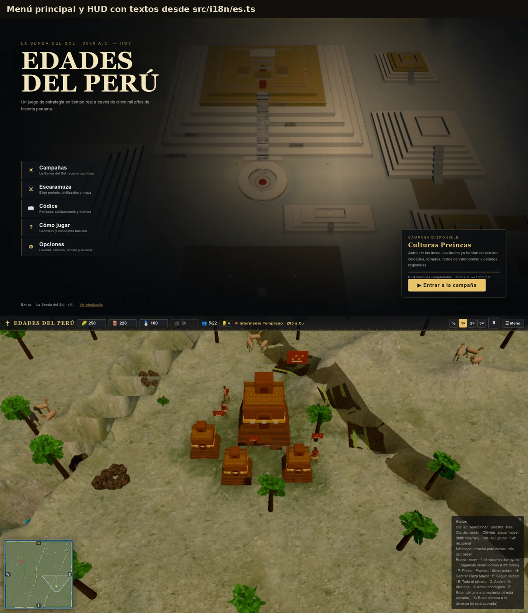

# Internationalisation (i18n)

Player-facing UI text lives in **`src/i18n/es.ts`**. Code imports `t` and uses a
typed flat key:

```ts
import { t } from '../i18n';

button.textContent = t('hud.pause.resume');
count.textContent = t('hud.tutorial.step', { current: 2, total: 5 });
```

The key type is derived from `es`, so a typo or a missing key is a TypeScript
error. `{name}` placeholders are replaced by the optional second argument.

## Rules

- **Spanish is the source locale** (`es.ts`) and the default; no language
  selector is exposed yet.
- Historical proper nouns (civilisation ids/names, mission ids, place names) are
  **data**, not UI copy: they stay in `src/model/defs/` and
  `src/campaign/defs/` and are never translated by this layer.
- `docs/historia/**` remains Spanish.
- Migrate incrementally: menu → HUD → tutorials → campaign. New UI must use
  `t()` instead of adding a Spanish literal.
- `tests/i18n.test.ts` checks interpolation, non-empty keys and guards the
  migrated UI files against new Spanish literals (including template expressions).
- ESLint rejects accented literals in `src/ui/**`, `src/core/Config.ts` and
  `src/core/hotkeys.ts`, pointing authors to `t()`.

## Scope

Migrated: main menu, title/cinematic labels, campaign hub, briefing chrome,
skirmish setup, controls, options, pause/victory chrome, in-match HUD, tech tree,
codex chrome, post-game stats and hotkey labels.

Still content/data by design: mission titles, briefings, educational text,
dossiers, building/unit/tech names and historical citations.


