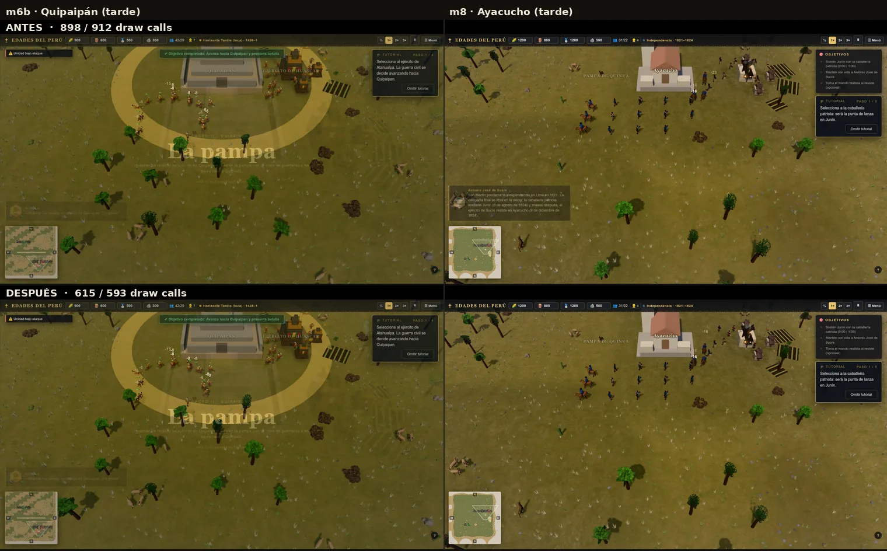

# Site-view performance (real GPU)

**Status:** living · **Measured:** 2026-11-17 (m3–m9, m6b, La Junta) and 2026-11-23 (the seven missions added
on 2026-11-18) · **Scope:** every campaign site view that rested on SwiftShader numbers.

This is the roadmap D3 pass. It records the shipped frame at 1280×800 and 1600×900 on the project's
reference iGPU and decides what to do with the result. The per-mission structural caps stay in
[`scripts/bench_scene.mjs`](../../scripts/bench_scene.mjs); this document does not relax them.

## Environment and method

- Intel i7-13700, Intel Graphics (RPL-S) via ANGLE/Vulkan in headless Chromium. The pass fails a row
  instead of recording it if the page falls back to SwiftShader.
- `yarn bench:site-views` (new) runs, for every mission and stage:
  - one **structural** row at 1600×900, which owns the triangle/call/mesh/material counts. It runs
    with `--gpu` and no `--assert`: the caps are calibrated on SwiftShader, so the software cap is
    shown for context, not enforced against the hardware-high row;
  - **shipped-frame** rows at 1280×800 and 1600×900 (`--frames --quality=high`), which own the frame
    time. Post-processing, the cinematic grade and water refraction are on.
- The quality governor is pinned to `high` and frozen for the sample, so these are worst-case numbers,
  not the low/medium presets the governor falls back to. Each frame value is a 2 s rAF sample.
- The three tightest late views are also sampled with `yarn bench:site-views --low` at the low preset
  (the same preset `?low=1` applies) to record the governor's fallback.
- Raw per-row JSON and `summary.md` are written to `review/site-views/` (gitignored); the command is
  reproducible from this commit.

## Results

Frame time is p50/p95 in milliseconds; counts and meshes/materials are the hardware-high structural row.
`FPS` is `1000 / p50` at 1600×900.

| Mission | Stage | 1280×800 | 1600×900 | FPS | Scene tris / calls | Meshes / materials |
| --- | --- | ---: | ---: | ---: | ---: | ---: |
| m3_moche_recuay | opening | 22.7 / 26.1 | 28.0 / 30.3 | 35.7 | 733,532 / 327 | 849 / 341 |
| m3_moche_recuay | late | 25.9 / 30.4 | 30.7 / 34.3 | 32.6 | 936,585 / 555 | 1,554 / 627 |
| m4_wari | opening | 20.7 / 23.7 | 26.2 / 27.9 | 38.2 | 618,807 / 192 | 405 / 146 |
| m4_wari | late | 23.4 / 26.0 | 27.9 / 30.8 | 35.8 | 725,526 / 341 | 1,010 / 380 |
| m5_yahuar_pampa | opening | 24.8 / 26.5 | 29.3 / 33.7 | 34.1 | 901,243 / 352 | 830 / 341 |
| m5_yahuar_pampa | late | 26.4 / 30.8 | 31.6 / 34.6 | 31.6 | 1,020,678 / 495 | 1,482 / 608 |
| m6_chimu_inca | opening | 21.7 / 25.5 | 27.0 / 29.5 | 37.0 | 663,215 / 265 | 780 / 313 |
| m6_chimu_inca | late | 25.7 / 29.0 | 30.7 / 33.1 | 32.6 | 968,560 / 508 | 1,453 / 590 |
| m6b_guerra_civil | opening | 25.3 / 29.2 | 30.2 / 32.4 | 33.1 | 948,311 / 428 | 1,198 / 487 |
| m6b_guerra_civil | late | 31.0 / 37.5 | 34.2 / 39.8 | 29.2 | 1,272,993 / 663 | 2,113 / 870 |
| m7_tupac_amaru | opening | 24.1 / 27.1 | 28.3 / 31.4 | 35.3 | 736,595 / 478 | 820 / 336 |
| m7_tupac_amaru | late | 28.2 / 32.7 | 32.9 / 37.2 | 30.4 | 1,044,570 / 718 | 1,492 / 589 |
| m8_independencia | opening | 26.1 / 29.2 | 30.6 / 34.1 | 32.7 | 859,263 / 574 | 1,013 / 453 |
| m8_independencia | late | 30.0 / 35.8 | 35.5 / 42.7 | 28.2 | 1,144,783 / 911 | 1,650 / 715 |
| m9_guerra_pacifico | opening | 22.5 / 25.0 | 27.6 / 29.9 | 36.2 | 696,029 / 435 | 896 / 360 |
| m9_guerra_pacifico | late | 26.7 / 29.8 | 31.5 / 38.0 | 31.7 | 1,018,707 / 745 | 1,625 / 669 |
| m_junta_cusco | opening | 26.8 / 30.3 | 31.8 / 36.5 | 31.4 | 916,333 / 665 | 1,279 / 524 |

### Quality fallback (1600×900)

| View | High p50 / FPS | Low p50 / FPS | Low tris / calls |
| --- | ---: | ---: | ---: |
| m6b_guerra_civil late | 34.2 / 29.2 | 21.5 / 46.5 | 1,015,707 / 659 |
| m8_independencia late | 35.5 / 28.2 | 21.6 / 46.3 | 911,787 / 907 |
| m7_tupac_amaru late | 32.9 / 30.4 | 20.2 / 49.5 | 811,766 / 714 |

The low preset removes the water refraction pass and drops the LODs; it turns the three sub-31 FPS
views into ~46–50 FPS views, so the governor's fallback is doing its job.

### Reading the numbers

- **Frame time:** the 2026-11-17 table is a snapshot. In it every view is at or above **28 FPS p50 at
  1600×900** and **32 FPS at 1280×800** in the worst-case high preset; B13 later moved its two tightest rows
  (m8 late, m6b late) to 34 FPS, and the seven openings measured on 2026-11-23 run **29–40 FPS**, dropping to
  27–30 on the two tightest under repeat sampling. The governor steps down below its 45 FPS window, so
  low/medium stay above 30 by construction.
- **Counts:** across the 24 rows of the two tables the hardware-high scene is 312k–1.27M triangles, 144–911
  calls and 146–870 materials, depending on the view and stage (the late rows carry the crowds). The
  local SwiftShader ratchet (`yarn bench:check`, not a CI job) is intentionally lower; for example m4
  measures 362,911 / 187 in software and 618,807 / 192 here. The delta is the high-quality LOD/kit and
  the shadow pass, not a regression. The global Tambotoco caps (500k/280 opening, 660k/360 late) and
  the per-mission ratchets are unchanged.
- **Late views** add 13–46% triangles and 41–92% calls over the opening: the unit crowds, their gear and
  the site's late dressing. m6b late is the heaviest (1.27M / 663), m8 late has the most calls (911).

## Decision

1. **Accept** the measured high-quality frame times on the reference iGPU. No site view is below ~27 FPS
   p50 at 1600×900 inside the measurement noise (the two openings at the floor are 27–30 and run 36–43 in the
   low preset), and the governor's low/medium presets are the playable path; 1280×800 is 31–48 FPS.
2. **Do not raise the scene caps.** They remain the local SwiftShader ratchet (`yarn bench:check`); the
   hardware-high counts are recorded here so a future pass can compare like with like.
3. **Schedule one optimization follow-up** (backlog B13): reduce the late-view cost of m6b (1.27M tris,
   29.2 FPS) and m8 (1.14M tris, 911 calls, 28.2 FPS), starting with unit-crowd LOD/shadow silhouette
   and material consolidation. Re-measure with `yarn bench:site-views` before and after.
4. Re-run the pass before release packaging (D4) and after any late-view art change.

## Tight rows and scope

The 2026-11-19 closeout re-ran the two tightest SwiftShader rows on `main`:

- `m8_independencia` opening: **618,602 / 597** against **625,000 / 660**. The row is green, but the
  margin is ~1 %; an earlier run measured 626,265 and the vegetation mix varies a few thousand triangles
  between runs. Do not add scene weight to m8 without re-measuring.
- `m6b_guerra_civil` late: **1,011,049 / 722** on idle runs (724–726 under load) against **1,025,000 / 740**
  (~2 % call margin). The 2026-11-22 pass made the 0.5 s opening garrison deterministic: the probe disables
  the intro guard so the settle updates advance the clock and `t_guarnicion` fires. (B13 later brought this
  row to **951,678 / 611**; see §"B13 follow-up".)

This document's 17 rows cover m3–m9, m6b and La Junta. The **openings** of the seven missions added on
2026-11-18 were measured on 2026-11-23 (§"The seven missions added on 2026-11-18"); they no longer rest on
SwiftShader alone. Their late views are still unmeasured — `bench_scene`'s late spawn has no scripted roster
for them and would fall back to a synthetic 30-worker crowd — so "every mission has a real-GPU opening
measurement" is the accurate claim.

## The seven missions added on 2026-11-18 (measured 2026-11-23)

`yarn bench:site-views --only=m_lima_1821,m_miraflores,m_real_felipe,m_tarapaca,m_vilcabamba,m_cusco_1536,m_brena
--stages=opening` — the same script, host and preset as the D3 pass. These seven are listed with `late: false`
in `bench_site_views.mjs` because their SwiftShader caps cover only the opening and `bench_scene`'s late spawn
has no scripted roster for them (it would fall back to the synthetic 30-worker crowd the generic missions get),
so a late row here would measure an invented scene rather than their second act.

| Mission | 1280×800 | 1600×900 | FPS | Scene tris / calls |
| --- | ---: | ---: | ---: | ---: |
| m_lima_1821 | 23.8 / 30.2 | 27.7 / 33.5 | 36.1 | 941,177 / 529 |
| m_miraflores | 21.7 / 26.3 | 25.9 / 32.9 | 38.6 | 865,204 / 377 |
| m_real_felipe | 23.5 / 27.8 | 33.8 / 41.9 | 29.6 | 809,050 / 506 |
| m_tarapaca | 20.9 / 25.3 | 25.0 / 31.2 | 40.0 | 312,159 / 144 |
| m_vilcabamba | 26.7 / 35.5 | 34.4 / 41.4 | 29.1 | 876,103 / 376 |
| m_cusco_1536 | 28.1 / 38.9 | 31.4 / 38.5 | 31.8 | 936,821 / 373 |
| m_brena | 31.9 / 42.9 | 28.1 / 32.7 | 35.6 | 868,204 / 452 |

The two tightest rows were sampled three more times each because a single 2 s window is noisy, and both were
also measured at the low preset (the same one the governor falls back to) with
`node scripts/bench_scene.mjs --mission=<id> --stage=opening --gpu --frames --quality=low --viewport=1600x900`
(`--low` in `bench:site-views` only samples the three late views it was written for):

| View | Pass | Three runs | Median | Low preset |
| --- | ---: | --- | ---: | ---: |
| m_real_felipe opening | 29.6 | 26 / 28 / 30 | **28** | 36.4 FPS (27.5 ms) |
| m_vilcabamba opening | 29.1 | 27 / 27 / 32 | **27** | 43.1 FPS (23.2 ms) |

**Decision:** accept, with one row recorded against the floor. Six of the seven are at or above 28 FPS
(`m_tarapaca` 40, `m_miraflores` 38.6, `m_lima_1821` 36.1, `m_brena` 35.6, `m_cusco_1536` 31.8,
`m_real_felipe` 28–30); **`m_vilcabamba` measures 27–29 (median 27)** and is the only site view at or just
below the D3 floor. Its low preset is 43 FPS and the governor steps down below its 45 FPS window, so the
playable path matches the rest of the campaign. `m_vilcabamba` and `m_real_felipe` are the first optimization
candidates if the floor moves up, ahead of any new scene weight; their structural counts are inside the
SwiftShader rows `yarn bench:check` already enforces (four of the seven show "(over, informational)" there
only because the structural column is the hardware-high count and the cap is calibrated on SwiftShader).

## B13 follow-up: where the late-view frame actually goes (2026-11-23)

`bench_scene.mjs --attribute` was added for this pass: it measures the scene once, then hides the unit
rigs, the landmark and the terrain and turns every unit caster off, reporting each delta. On the two
tightest views it says the crowd owns the draw calls but **not** the frame:

| View | Units | Unit calls (shadows included) | Of those, shadows | Unit triangles | FPS p50 |
| --- | --- | ---: | ---: | ---: | ---: |
| m6b late | 70 | 694 (77 % of 898) | 70 | 665k (50 %) | 27.0 |
| m8 late | 36 | 687 (75 % of 912) | 114 | 420k (42 %) | 28.8 |

Hiding a unit's group also drops its shadow casters, so the unit column includes the shadow draw calls; the
shadow column is that subset, not an extra cost on top.

### What was measured

1. **Material consolidation of the character rigs** (`consolidateRig` now merges the rigid bone-attached
   gear — morion, backplate, breeches, boots, sleeves, sandals — into the same skinned draws as the body
   and garments, keeping only the parts that toggle visibility at runtime). Per-unit draws from
   `yarn bench:characters`: Inca 14 → **9**, Spanish 22 → **6**, 1879 fusilier 20 → **6**, Moche 12 → **9**,
   Wari 13 → **9**, Chimú 10 → **9**, late realista 22 → **6**. The merged draw takes the first part's
   roughness/metalness, so a morion or a breastplate now reads as matte metal at the RTS zoom (its colour is
   preserved in the vertex colours); the visual baselines cover that trade.
2. **The result on the scene:** m6b late 898 → **615** calls (−31 %), m8 late 912 → **593** (−35 %).
3. **The result on the frame at 1600×900:** m6b 36.4 → 36.9 ms p50 (27 FPS both, three interleaved runs
   per build) and m8 32.2 → 32.2 ms. A quarter of the draw calls bought nothing: the late view is not
   draw-bound on this iGPU.
4. **Per-pass attribution** (`--frames --no-refraction` / `--direct`): the water refraction re-render costs
   **9.6 ms of 36.5** on m6b, 8.4 ms on m8 and 9.2 ms on m_lima; post-processing costs ~4 ms. That extra
   full-scene pass was the single biggest item in the late frame, so it now runs every **second** frame
   (`RuntimeController.renderWaterRefraction`, refreshed at 30 Hz into a half-resolution target that the
   water shader already distorts).
5. **Cull the merged rig draws.** The merged garments/gear were `frustumCulled = false` (a skinned mesh with
   an unreliable bound), so an off-screen unit still paid for all of its equipment — 26.7k triangles of gear
   for units outside the late m6b view alone. The merged geometry now gets a bind-pose bounding sphere with a
   35 % margin (computed once per variant and handed to the mesh, because `Frustum` prefers a `SkinnedMesh`'s
   own sphere) and culls again.
6. **Only the body casts a unit's shadow.** `bodyOnlyShadows` (the rule the worker already had) now applies to
   the post-colonial and modern rigs too: the merged garments and gear are one skinned draw in the main pass,
   not a second copy in the shadow pass.

### After

`yarn bench:site-views --only=m6b_guerra_civil,m8_independencia --stages=late`, before and after on the same
host. The FPS columns are the median of three 2 s samples (the pass itself is one sample and already shows
the spread; see `review/b13-final2/`).

| View | Viewport | Draw calls | FPS p50 before | FPS p50 after |
| --- | --- | ---: | ---: | ---: |
| m6b late | 1280×800 | 883 → 600 | 31.3 | **40.0** |
| m6b late | 1600×900 | 898 → **615** | 27.0 | **34** |
| m8 late | 1280×800 | 910 → 590 | 33.8 | **41.7** |
| m8 late | 1600×900 | 912 → **593** | 28.8 | **34** |

(`m_lima` late, measured ad hoc while isolating the refraction lever: 36.6 ms p50 with the pass every frame,
31.0 ms with the every-second-frame pass and 27.4 ms with the pass off — the last is the ceiling, not a
shipped configuration.)

The local `yarn bench:check` ratchet was **already red on `main`** when this pass started: the character
equipment shipped in #609–#613 raised the late m6b row from the recorded 1,011,049 triangles to **1,053,169**
(and 722 → 894 calls), because every soldier's new gear is one more draw and a few hundred more triangles.
Reproduce with `node scripts/bench_scene.mjs --mission=m6b_guerra_civil --stage=late --assert` on `a25c6547`;
no cap was raised and the row is green again:

| Row | Cap | `main` before this PR | After |
| --- | ---: | ---: | ---: |
| m6b late | 1,025,000 / 740 | 1,053,169 / 894 | **951,678 / 611** |
| m8 late | 920,000 / 1,325 | 753,947 / 906 | **669,488 / 589** |

**Decision:** B13 is closed with a measured win, not a reject. Three levers were kept (rig consolidation, the
refraction cadence and the culling of merged rig draws) and one was rejected: a view-dependent refraction gate
(skip the pass when no water is on screen) would save the same ~9 ms on inland views — m6b's late frame has no
water at all — but it pops the reflection on and off while panning, which the art direction does not accept.
